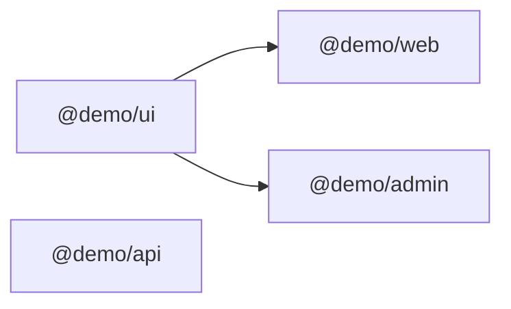

import { FileTree, Tabs, TabItem } from '@astrojs/starlight/components'
import Timeline from '../../../components/running/Timeline.astro'
import ProjectMap from '../../../components/running/ProjectMap.astro'

export const neverEnds = { lanes: [{ task: '@demo/web#e2e', bars: [{ from: 0, to: 20, tone: 'warn', label: 'still running…', open: true }] }] }
export const limitHit = { lanes: [{ task: '@demo/web#e2e', bars: [{ from: 0, to: 10, tone: 'danger', label: 'timed out' }] }], marks: [{ at: 10, label: 'limit', tone: 'danger' }] }
import { Levels, Deeper, Concept, Quiz, Walkthrough, Frame, Takeaway, NextStep } from '../../../components/learn'
import { RunTimeline } from '../../../components/play'
import RunPicker from '../../../components/demos/RunPicker.astro'
import ErrorFinder from '../../../components/docs/troubleshooting/ErrorFinder.astro'

`vx run <task>` runs a task, and every task it needs first.

```sh
cd packages/web
vx run build
```

<Levels />

Your workspace has tasks and a dev server. Now run them on purpose: one
project, what changed, or everything. Each section ends with something new
you can do.

## Meet the workspace

The `ui` kit and the `web` app from the last pages have company: an
**admin** panel that also uses `ui`, and an **api** that stands alone.

<FileTree>
- .vx/workspace.ts
- packages/
  - ui/ vx.config.ts, src/
  - web/ vx.config.ts, src/
  - admin/ vx.config.ts, src/
  - api/ vx.config.ts, src/
</FileTree>



An arrow reads "is used by". Every project declares the same three
tasks: `build` runs `vite build`, `test` runs `vitest run`, `lint` runs
`oxlint src`.

```ts title="packages/web/vx.config.ts" mark={6,13}
import { defineProject } from '@vzn/vx/config'

export default defineProject({
  tasks: {
    build: {
      dependsOn: ['^build'],
      exec: { command: 'vite build' },
      inputs: { files: ['src/**', 'vite.config.ts'] },
      outputs: { files: ['dist/**'] },
      cache: true,
    },
    test: {
      dependsOn: ['^build'],
      exec: { command: 'vitest run' },
      inputs: { files: ['src/**'] },
      outputs: { files: [] },
      cache: true,
    },
    lint: {
      exec: { command: 'oxlint src' },
      inputs: { files: ['src/**'] },
      outputs: { files: [] },
      cache: true,
    },
  },
})
```

<Concept term="^build">
  "First build every project I use." It is why `web` never builds or
  tests against a stale `ui`. [Tasks](../tasks/) explains every key.
</Concept>

<Takeaway>read a workspace's graph: who uses whom, and which tasks wait on which.</Takeaway>

## 1. Run one task

Stand in a project and name the task.

```sh
cd packages/web
vx run build
```

```ansi
┌─ @demo/web#build > $ vite build
vite v8.3.8 building client environment for production...
transforming...
✓ 2 modules transformed.
rendering chunks...
computing gzip size...
dist/index.js  0.04 kB │ gzip: 0.06 kB

✓ built in 23ms
└─ @demo/web#build ── (175ms) success

  Summary                                           vx 0.0.0
  projects  ▰▰▰▰▰▰▰▰▰▰▰▰▰▰▰▰▰▰▰▰▰▰▰▰▱▱▱▱▱▱▱▱▱▱▱▱▱▱▱▱▱▱▱▱▱▱▱▱
            2 in run · 4 total
  tasks     ▰▰▰▰▰▰▰▰▰▰▰▰▰▰▰▰▰▰▰▰▰▰▰▰▰▰▰▰▰▰▰▰▰▰▰▰▰▰▰▰▰▰▰▰▰▰▰▰
            2 success · 2 total
  cache     ▰▰▰▰▰▰▰▰▰▰▰▰▰▰▰▰▰▰▰▰▰▰▰▰▰▰▰▰▰▰▰▰▰▰▰▰▰▰▰▰▰▰▰▰▰▰▰▰
            local 2↑

  info      4 workers · local cache
            run 01a209e3-0de6-71d5-ab92-cdade8d7e559
  time      2.16s · max 1.89s · avg 1.03s · min 175ms
```

Look at `2 in run`. You asked for one build and got two: `@demo/ui`
built first, because `web` waits on it. Only `web`'s log is shown; the
tasks it needs run quietly unless they fail.

<Takeaway>build any project, with everything it needs, from inside its folder.</Takeaway>

## 2. Run it everywhere

From the workspace root, `--all` runs the task in every project that
declares it. Step through three runs of the same command:

<Walkthrough title="vx run build --all, three times">
<Frame title="1. Two builds run, two are up to date">

```ansi
  Tasks     status  cache       time   task                 
            success miss       239ms   @demo/admin#build
            success miss       250ms   @demo/api#build

  Summary                                           vx 0.0.0
  projects  ▰▰▰▰▰▰▰▰▰▰▰▰▰▰▰▰▰▰▰▰▰▰▰▰▰▰▰▰▰▰▰▰▰▰▰▰▰▰▰▰▰▰▰▰▰▰▰▰
            4 in run · 4 total
  tasks     ▰▰▰▰▰▰▰▰▰▰▰▰▰▰▰▰▰▰▰▰▰▰▰▰▰▰▰▰▰▰▰▰▰▰▰▰▰▰▰▰▰▰▰▰▰▰▰▰
            4 success · 4 total
  cache     ▰▰▰▰▰▰▰▰▰▰▰▰▰▰▰▰▰▰▰▰▰▰▰▰▰▰▰▰▰▰▰▰▰▰▰▰▰▰▰▰▰▰▰▰▰▰▰▰
            local 2✓ 2↑

  info      4 workers · local cache
            run 01a209e3-1732-778a-91fc-b29646d51ca2
  time      335ms · max 250ms · avg 245ms · min 239ms
```

Only `api` and `admin` ran. `ui` and `web` were built in section 1, so
the `cache` line counts them as `2✓`.

</Frame>
<Frame title="2. Again: nothing changed, nothing runs">

```ansi
  Summary                                           vx 0.0.0
  projects  ▰▰▰▰▰▰▰▰▰▰▰▰▰▰▰▰▰▰▰▰▰▰▰▰▰▰▰▰▰▰▰▰▰▰▰▰▰▰▰▰▰▰▰▰▰▰▰▰
            4 in run · 4 total
  tasks     ▰▰▰▰▰▰▰▰▰▰▰▰▰▰▰▰▰▰▰▰▰▰▰▰▰▰▰▰▰▰▰▰▰▰▰▰▰▰▰▰▰▰▰▰▰▰▰▰
            4 success · 4 total
  cache     ▰▰▰▰▰▰▰▰▰▰▰▰▰▰▰▰▰▰▰▰▰▰▰▰▰▰▰▰▰▰▰▰▰▰▰▰▰▰▰▰▰▰▰▰▰▰▰▰
            local 4✓

  info      4 workers · local cache
            run 01a209e3-1955-7040-9ef8-c6e9ce4e0285
  time      27ms
```

`4✓` in 27 ms. Every output is already on disk.

</Frame>
<Frame title="3. Delete every dist/, then run again">

```sh
rm -rf packages/*/dist
vx run build --all
```

```ansi
  Summary                                           vx 0.0.0
  projects  ▰▰▰▰▰▰▰▰▰▰▰▰▰▰▰▰▰▰▰▰▰▰▰▰▰▰▰▰▰▰▰▰▰▰▰▰▰▰▰▰▰▰▰▰▰▰▰▰
            4 in run · 4 total
  tasks     ▰▰▰▰▰▰▰▰▰▰▰▰▰▰▰▰▰▰▰▰▰▰▰▰▰▰▰▰▰▰▰▰▰▰▰▰▰▰▰▰▰▰▰▰▰▰▰▰
            4 success · 4 total
  cache     ▰▰▰▰▰▰▰▰▰▰▰▰▰▰▰▰▰▰▰▰▰▰▰▰▰▰▰▰▰▰▰▰▰▰▰▰▰▰▰▰▰▰▰▰▰▰▰▰
            local 4↓

  info      4 workers · local cache
            run 01a209e3-1a30-7505-94b8-cf81ab7d820f
  time      53ms
```

`4↓`: vx put each `dist/` back from its cache instead of building.

</Frame>
</Walkthrough>

The `cache` line always tells you which of these happened:

| Mark | Means | The task |
| ---- | ----- | -------- |
| `✓` | up to date: its outputs are already on disk | did not run |
| `↓` | restored from the cache | did not run |
| `↑` | ran, then saved to the cache | ran |
| `∅` | ran with no cache | ran |

<Takeaway>run a task across the whole workspace, and read from one line what ran and what was skipped.</Takeaway>

## 3. Choose the projects

`--filter` picks projects by name, by folder, or by where they sit in
the graph. Pick a task and a filter below and watch what lights up.

<RunPicker />

The filters you will use most:

| Filter | Picks |
| ------ | ----- |
| `@demo/web` | that project |
| `web` | the same: the scope may be left out |
| `@demo/*` | every project whose name matches |
| `./packages/api` | the project in that folder |
| `@demo/web...` | `web` and everything it uses |
| `...@demo/ui` | `ui` and everything that uses it |
| `!@demo/api` | everything except `api` |

The same `...@demo/ui` in a real plan. Every project that uses `ui`
tests against its fresh build:

```sh
vx run test --filter '...@demo/ui' --dry
```

```ansi
  Plan 4    status  cache       time   task                 
            run     miss           —   @demo/admin#test
            cached  local          —   @demo/ui#build
            run     miss           —   @demo/ui#test
            run     miss           —   @demo/web#test

  tasks     4 planned · 1 cache hit (1 local) · 3 would run
```

Every filter must match a project. A typo stops the run before anything
starts, and `fix` names what you meant:

```sh
vx run test --filter @demo/wbe
```

```ansi
✗ vx run  no projects matched filter(s): "@demo/wbe"

  fix  @demo/web
```

<Deeper level="details" title="Every filter form, and how filters combine">

| Form | Picks |
| ---- | ----- |
| `<name>` | projects by name; `*` matches anything, `/` included |
| `./<dir>` or `{<dir>}` | the project in that folder, or every project under it |
| `./<glob>` | projects whose folder matches: `./packages/*` |
| `<name>{<dir>}` | projects matching the name inside that folder |
| `.` | the root project (else every project) |
| `//` | the root project alone |
| `tag:<name>` | projects whose config `tags` match |
| `<f>...` | the match and everything it uses |
| `...<f>` | the match and everything that uses it |
| `<f>^...` | only what the match uses, not the match |
| `...^<f>` | only what uses the match, not the match |
| `...<f>...` | the match, what uses it, and what all of those use |
| `[<ref>]` | projects with files changed since a git ref: `[origin/main]` |
| `<f>[<ref>]` | the match, if it changed since the ref |
| `<f>...[<ref>]` | the match, if it or anything it uses changed |
| `!<f>` | remove these from the selection |

Filters combine in a fixed order:

1. Every include is added up: `--filter web --filter api` runs both.
2. Then every `!` removes from the result, wherever it was written.
3. A run with only `!` filters starts from every project.

"Uses" comes from two places: your [lockfile plugin](../lockfiles/),
which reads what the package manager installed, and any cross-project
`dependsOn` such as `'api#build'`.

Full grammar and error messages: [`--filter`](../../cli/run/#filter-dsl---filter).

</Deeper>

<Deeper level="patterns" title="Run one project's tasks">

### Run one project's tasks

A filter picks where to **start**. What those tasks depend on still comes
along. Filter on `web`, and its `^build` builds `ui` first:

```sh
vx run build --filter @demo/web --dry
```

```ansi
  Plan 2    status  cache      usual    time   cpu    mem outputs  blocks worker         task
            run     miss        ~6ms       —     —      —       —       0 local          @demo/web#build
            run     miss       ~12ms       —     —      —       —       1 local          @demo/ui#build

  tasks      2 planned · 2 would run
  predicted  ~18ms wall · ~18ms total execution
```

Two rows, not one: `@demo/ui#build` blocks `web`, so it runs too. When you
know the dependencies are built, add `--exclude-dependencies` to run only
the picked tasks.

<Takeaway>work on one app and trust that what it needs is built first.</Takeaway>

</Deeper>

<Takeaway>run a task in exactly the projects you mean, by name, folder or neighbours.</Takeaway>

## 4. Run only what changed

You open a branch and edit `ui` and `api`. `--affected` runs only the
tasks your change can reach. Add `--dry` to see the list first:

```sh
vx run test --affected=main --dry
```

```ansi
  Plan 5    status  cache       time   task                 
            run     miss           —   @demo/admin#test  affected: packages/ui/src/index.ts changed (an input), via @demo/ui#build
            run     miss           —   @demo/ui#build
            run     miss           —   @demo/api#test  affected: packages/api/src/index.ts changed (an input)
            run     miss           —   @demo/ui#test  affected: packages/ui/src/index.ts changed (an input)
            run     miss           —   @demo/web#test  affected: packages/ui/src/index.ts changed (an input), via @demo/ui#build

  tasks      5 planned · 5 would run
  predicted  ~1.89s wall · ~1.89s total execution · 4 tasks
             never timed (+?)
```

Every row says why it is there. `web#test` runs because `ui` changed and
it waits on `ui#build`. Try **`--affected`** in the picker above, then
switch the task to `lint`.

<Quiz q="On a new branch you change only packages/api/src/index.ts. Which tasks does vx run test --affected start?">
  Only `@demo/api#test`. Nothing uses `api`, so the change reaches no
  other project.
</Quiz>

<Deeper level="details" title="Which commit --affected compares with">

Bare `--affected` picks its base, the first that applies:

1. `VX_AFFECTED_BASE`, if set.
2. A plugin's base, such as the pull request's base branch on GitHub.
3. The merge base of `HEAD` and `origin/<baseBranch>`.

`baseBranch` is `origin/HEAD`'s branch, else `main`, else `master`.
Set it in [`.vx/workspace.ts`](../workspace/) or with `VX_BASE_BRANCH`.

- Comparing from the **merge base** means you see only your branch's
  changes, never what others merged to `main` since.
- On the base branch itself there is nothing to compare with, so vx
  refuses. Use `--all`: the cache already skips what did not change.
- A shallow CI clone is fine. vx fetches the history it needs, no file
  contents.
- Write the value with `=`: `--affected=origin/main`. In
  `--affected main`, `main` is read as a task name.

What marks a task: a changed file in its `inputs`, a changed
`vx.config.ts`, or a changed file no task of its project declares.

A change then travels only along `dependsOn`. Full rules: [`--affected`](../../cli/run/#--affectedbase).

</Deeper>

<Deeper level="patterns" title="Run only what changed">

### Run only what changed

`--affected` picks **projects** from git. The cache then decides what
really runs. Three edits on a branch, three plans. The orange dot is the
edit; bright boxes are affected.

<Tabs>
<TabItem label="Edit ui/src">

<ProjectMap picked={['ui', 'web', 'admin']} changed="ui" label="An edit in @demo/ui affects ui, web and admin" />

`ui` changed, and both apps use it. All three rebuild:

```ansi
  Plan 3    status  cache      usual    time   cpu    mem outputs  blocks worker         task                           
            run     miss      ~210ms       —     —      —       —       0 local          @demo/admin#build  affected: packages/ui/src/index.ts changed (an input), via @demo/ui#build
            run     miss      ~306ms       —     —      —       —       2 local          @demo/ui#build  affected: packages/ui/src/index.ts changed (an input)
            run     miss        ~3ms       —     —      —       —       0 local          @demo/web#build  affected: packages/ui/src/index.ts changed (an input), via @demo/ui#build

  tasks      3 planned · 3 would run
  predicted  ~516ms wall · ~519ms total execution
```

</TabItem>
<TabItem label="Edit web/src">

<ProjectMap picked={['web']} changed="web" label="An edit in @demo/web affects only web" />

Nothing uses `web`, so only `web` rebuilds. `ui` comes along as a
dependency and is a cache hit:

```ansi
  Plan 2    status  cache      usual    time   cpu    mem outputs  blocks worker         task                           
            run     miss        ~3ms       —     —      —       —       0 local          @demo/web#build  affected: packages/web/src/index.ts changed (an input)
            cached  local          —       —     —      —       —       1 local          @demo/ui#build

  tasks      2 planned · 1 cache hit (1 local) · 1 would run
  predicted  ~3ms wall · ~3ms total execution
```

</TabItem>
<TabItem label="Edit ui/README.md">

<ProjectMap picked={['ui', 'web', 'admin']} changed="ui" label="A README edit in @demo/ui marks all three affected, yet all three are cache hits" />

The README is in `ui`, so all three are affected. No task reads it, so
all three are cache hits and nothing runs:

```ansi
  Plan 3    status  cache      usual    time   cpu    mem outputs  blocks worker         task                           
            cached  local          —       —     —      —       —       0 local          @demo/admin#build  affected: packages/ui/README.md changed (in its project), via @demo/ui#build
            cached  local          —       —     —      —       —       2 local          @demo/ui#build  affected: packages/ui/README.md changed (in its project)
            cached  local          —       —     —      —       —       0 local          @demo/web#build  affected: packages/ui/README.md changed (in its project), via @demo/ui#build

  tasks     3 planned · 3 cache hits (3 local)
```

</TabItem>
</Tabs>

<Takeaway>predict any branch's run: git picks the projects, the cache skips the unchanged tasks.</Takeaway>

</Deeper>

<Takeaway>test only what a branch touched, and see why each task made the cut.</Takeaway>

## 5. Several tasks in one run

Name as many tasks as you like. They share one graph, so nothing runs
twice and independent tasks run side by side.

```sh
vx run lint test --filter @demo/api
```

```ansi
  Tasks     status  cache       time   task                 
            success miss       1.28s   @demo/api#lint
            success miss       2.04s   @demo/api#test

  Summary                                           vx 0.0.0
  projects  ▰▰▰▰▰▰▰▰▰▰▰▰▱▱▱▱▱▱▱▱▱▱▱▱▱▱▱▱▱▱▱▱▱▱▱▱▱▱▱▱▱▱▱▱▱▱▱▱
            1 in run · 4 total
  tasks     ▰▰▰▰▰▰▰▰▰▰▰▰▰▰▰▰▰▰▰▰▰▰▰▰▰▰▰▰▰▰▰▰▰▰▰▰▰▰▰▰▰▰▰▰▰▰▰▰
            2 success · 2 total
  cache     ▰▰▰▰▰▰▰▰▰▰▰▰▰▰▰▰▰▰▰▰▰▰▰▰▰▰▰▰▰▰▰▰▰▰▰▰▰▰▰▰▰▰▰▰▰▰▰▰
            local 2↑

  info      4 workers · local cache
            run 01a209e3-1ebb-7511-95b7-9e3549f5073a
  time      2.08s · max 2.04s · avg 1.66s · min 1.28s
```

Two more ways to name tasks, from anywhere in the workspace:

```sh
vx run @demo/api#test       # one project's task, exactly
vx run //#build             # the root project's task
```

<Takeaway>run a whole check (lint, test, build) as one command.</Takeaway>

Change the slots, make a task fail, and toggle `--fail-fast` to see what the run does:

<RunTimeline concurrency={2} />

## 6. Pass flags to the tool

Everything after `--` goes to the task's command.

```sh
vx run @demo/web#test -- --reporter=dot
```

```ansi
┌─ @demo/web#test > $ vitest run --reporter=dot

·

 Test Files  1 passed (1)
      Tests  1 passed (1)
   Start at  19:30:12
   Duration  163ms (import 43%, transform 33%, worker 13%, tests 10%, environment 1%)

└─ @demo/web#test ── (479ms) success

  Summary                                           vx 0.0.0
  projects  ▰▰▰▰▰▰▰▰▰▰▰▰▰▰▰▰▰▰▰▰▰▰▰▰▱▱▱▱▱▱▱▱▱▱▱▱▱▱▱▱▱▱▱▱▱▱▱▱
            2 in run · 4 total
  tasks     ▰▰▰▰▰▰▰▰▰▰▰▰▰▰▰▰▰▰▰▰▰▰▰▰▰▰▰▰▰▰▰▰▰▰▰▰▰▰▰▰▰▰▰▰▰▰▰▰
            2 success · 2 total
  cache     ▰▰▰▰▰▰▰▰▰▰▰▰▰▰▰▰▰▰▰▰▰▰▰▰▰▰▰▰▰▰▰▰▰▰▰▰▰▰▰▰▰▰▰▰▰▰▰▰
            local 2↑

  info      4 workers · local cache
            run 01a209e3-27ab-73e4-abe4-c07131ecbe3c
  time      743ms · max 479ms · avg 335ms · min 191ms
```

The first line shows what ran: `vitest run --reporter=dot`. The
forwarded words are part of the task's cache key, so a run with other
flags is never replayed for this one.

Forwarding needs one task in one project. vx does not guess which
command a flag was meant for:

```sh
vx run test --all -- --bail
```

```ansi
✗ vx run  forwarded args (after --) go to one task in one
          project, and this run asks for 4:
          @demo/admin#test, @demo/api#test, @demo/ui#test,
          …; run that task alone, e.g. vx run
          @demo/admin#test -- …
```

vx has no short flags. Type `vx run test -t adds --filter @demo/api`
and vx catches the `-t`; `fix` shows where it goes:

```ansi
✗ vx run  unknown flag: -t

  see vx run --help

  fix  vx run test --filter @demo/api -- -t adds
```

<Deeper level="details" title="Where forwarded words land">

- They are shell-quoted, then added to the end of the command's last
  line.
- A trailing `;` or `&` stays last: the words go before it.
- In a compound command (`(cd web && vite)`, `if …; fi`) they go to its
  last command, where the shell still reads arguments.
- Another tool's flag name is hinted: `-j` and `--parallel` hint
  `--concurrency`; `-F` and `--scope` hint `--filter`.

Full rules: [argument forwarding](../../cli/run/#argument-forwarding---).

</Deeper>

<Takeaway>hand any flag to vite, vitest or oxlint through vx.</Takeaway>

## 7. See the plan first

You edit `ui` again. Before running, ask what would happen:

```sh
vx run build --all --dry
```

```ansi
  Plan 4    status  cache       time   task                 
            run     miss           —   @demo/admin#build
            run     miss           —   @demo/ui#build
            cached  local          —   @demo/api#build
            run     miss           —   @demo/web#build

  tasks      4 planned · 1 cache hit (1 local) · 3 would run
  predicted  ~2.13s wall · ~2.30s total execution
```

Nothing ran. Read it row by row:

- `api#build` is `cached local`: it comes from the cache, since `api`
  did not change.
- The other three `run`: `ui` changed, and `web` and `admin` build on it.
- `predicted` adds up how long these tasks took last time: about 2 s.

`--dry --format json` prints the same plan for scripts. The next page
browses it.

<Takeaway>know what a run does, and roughly how long it takes, before you start it.</Takeaway>

## 8. Tune the run

The flags you will reach for most:

| Flag | Does |
| ---- | ---- |
| `--concurrency <n>` | at most `n` tasks at once |
| `--fail-fast` | stop everything at the first failure |
| `--timeout <time>` | a time limit per task: `30s`, `10m` |
| `--force` | run every task, even when the cache has it |
| `--no-cache` | no cache at all for this run |

<Deeper level="details" title="Every vx run flag">

Most flags also have a setting in [`.vx/workspace.ts`](../workspace/)
and a `VX_*` variable. The flag wins, then the variable, then the
setting.

**What runs**

| Flag | Does |
| ---- | ---- |
| `--all` | every project that declares the task. Off: only the project you are in |
| `--filter <f>` | projects the filter picks; repeat it to add more. Default: none |
| `--affected[=<ref>]` | the tasks a change since `<ref>` reaches. Default: off |
| `--exclude-dependencies[=<names>]` | skip `dependsOn`: all of it, or only the named tasks. Default: off |

**Cache**

| Flag | Does |
| ---- | ---- |
| `--no-cache` | no cache reads or writes; outputs are left alone. Default: off |
| `--force` | run every task, then save over the cache's entry. Default: off |
| `--cache-policy <spec>` | reads and writes per cache: `local:rw,remote:r`. Default: every cache reads and writes |
| `--cache-dir <path>` | where the local cache lives. Default: `.vx/cache`, entries in `~/.vx/<id>/cache` |
| `--cache-download <mode>` | `all`, `toplevel` or `none`: which remotely run outputs come home. Default: `all` |
| `--cache-concurrency-download <n>` | remote downloads at once. Default: 64 to 96, by cores |
| `--cache-concurrency-upload <n>` | uploads at once, per remote. Default: 64 to 96, by cores |
| `--cache-concurrency-restore <n>` | local hits restored at once. Default: twice `--concurrency` |

**Speed and order**

| Flag | Does |
| ---- | ---- |
| `--concurrency <n>` | at most `n` tasks at once; `50%` is half the cores. Default: every core you may use |
| `--schedule <rule>` | which ready task starts first: `most-work`, `critical-path`, `direct-dependents`, `ready-order`. Default: `most-work` |

**Failures and limits**

| Flag | Does |
| ---- | ---- |
| `--fail-fast` | stop everything at the first failure. Off: a failure skips only what waits on it |
| `--retries <n>` | re-run a failed task up to `n` more times. Default: `0` |
| `--timeout <time>` | a time limit for tasks without their own. Default: none |

**Output and records**

| Flag | Does |
| ---- | ---- |
| `--output-logs <mode>` | `full`, `errors-only`, `hash-only` or `none`. Default: `errors-only` on CI |
| `--verbosity <n>` | `1` adds a table of every task after the run. Default: `0` |
| `--dry` | print the plan, run nothing. Default: off |
| `--format <fmt>` | with `--dry`: `pretty` or `json`. Default: `pretty` |
| `--profile[=<file>]` | write a Chrome trace of the run. Default: off (`profile.json`) |
| `--branch <name>` | the branch the run's history is filed under. Default: git's branch |

Rules every flag follows:

- An optional value takes `=`: `--affected=main`, `--profile=run.json`.
- A flag given twice keeps the last value.
- `--no-cache` beats `--force`. `--retries`, `--timeout` and
  `--cache-download` never change a cache key.
- Numbers are plain (`0x10` is refused); a time needs its unit (`500ms`).
- An unknown flag is refused with the nearest real one:
  `--concurency` shows `fix --concurrency`.

| Exit code | When |
| --------- | ---- |
| `0` | every task passed or came from the cache |
| `1` | a task failed or was skipped, or the command was wrong |
| `130` | you pressed Ctrl-C (`143` for SIGTERM, `129` for SIGHUP) |

Every detail: [`vx run`](../../cli/run/).

</Deeper>

<Deeper level="patterns" title="Stop at the first failure">

### Stop at the first failure

`ui`'s test fails fast. `web`'s test takes a second. Pick a tab and watch.

<Tabs>
<TabItem label="Default">

<Timeline
  label="ui's test fails at 12 ms; web's test keeps running and passes at 1.01 s"
  end={1100}
  unit="ms"
  lanes={[
    { task: '@demo/ui#test', bars: [{ from: 0, to: 12, tone: 'danger' }] },
    { task: '@demo/web#test', bars: [{ from: 0, to: 1010, tone: 'ok', label: 'success' }] },
  ]}
  marks={[{ at: 12, label: 'ui fails', tone: 'danger' }]}
/>

`web` runs to the end. One run shows you **every** failure. Only the
tasks that need a failed one are skipped:

```sh
vx run test --all
```

```ansi
  Tasks     status  cache     ±usual    time   cpu    mem outputs  blocks worker         task                           
            failed  no-cache       —    12ms    9%  1.7MB       —       0 local          @demo/ui#test
            success no-cache       —   1.01s    0%  3.6MB       —       0 local          @demo/web#test

┌─ @demo/ui#test > failed (exit 1)

packages/ui $ echo 'expected 2, got 1' && exit 1

├─ OUTPUT ────────────────────────────────────────────────────

expected 2, got 1

└─ @demo/ui#test ── (12ms) failed (exit 1)
```

</TabItem>
<TabItem label="--fail-fast">

<Timeline
  label="ui's test fails at 12 ms; vx stops web's test at 19 ms"
  end={1100}
  unit="ms"
  lanes={[
    { task: '@demo/ui#test', bars: [{ from: 0, to: 12, tone: 'danger' }] },
    { task: '@demo/web#test', bars: [{ from: 0, to: 19, tone: 'warn' }] },
  ]}
  marks={[{ at: 12, label: 'ui fails', tone: 'danger' }]}
/>

vx kills `web` and ends the run. Its row says `aborted`:

```sh
vx run test --all --fail-fast
```

```ansi
  Tasks     status  cache     ±usual    time   cpu    mem outputs  blocks worker         task                           
            failed  no-cache       —    12ms    9%  1.7MB       —       0 local          @demo/ui#test
            aborted —              —    19ms     —      —       —       0 local          @demo/web#test
```

</TabItem>
</Tabs>

Both exit `1`, and neither caches a failed or aborted task. To make it the
default, set `run: { failFast: true }` in `.vx/workspace.ts`, or
`failFast: true` on one [pipeline](../ci/run-a-pipeline/).

A flaky task can get extra attempts first: `exec.retries: 2` means up to
three runs. `--fail-fast` waits until a task is out of attempts.

<Takeaway>choose per run: every failure at once, or the first one back sooner.</Takeaway>

</Deeper>

<Deeper level="patterns" title="Set a time limit on a task">

### Set a time limit on a task

A task has **no** time limit unless you set one. One test waits for a page
that never loads. Pick a tab.

<Tabs>
<TabItem label="No limit">

<Timeline label="e2e starts and never ends; the run hangs" end={20} unit="m" {...neverEnds} />

The run waits forever.

</TabItem>
<TabItem label="timeout: '10m'">

<Timeline label="e2e runs until the 10 minute limit, then vx stops it and it fails as timed out" end={20} unit="m" {...limitHit} />

At ten minutes vx stops it. The task fails, and the run ends.

```ts title="packages/web/vx.config.ts" ins={3}
tasks: {
  e2e: {
    exec: { command: 'playwright test', timeout: '10m' },
  },
},
```

</TabItem>
</Tabs>

To try it, pass `--timeout` to one run. Here the task sleeps five seconds:

```sh
vx run @demo/web#e2e --timeout 1s
```

```ansi
┌─ @demo/web#e2e > $ sleep 5
[vx] timed out after 1000ms — killed (SIGTERM)
└─ @demo/web#e2e ── (1.01s) failed (timed out, exit 143)
```

Read the last word: `failed (timed out)`. vx exits `1`, and a timed-out
task is never cached.

| Where | Setting | Applies to |
| --- | --- | --- |
| a task in `vx.config.ts` | `exec: { timeout: '10m' }` | that task |
| command line | `--timeout 10m` | every task in this run |
| `.vx/workspace.ts` | `run: { timeout: '30m' }` | every task in every run |

The most specific wins: `exec.timeout` beats `--timeout`, which beats
`run.timeout`. A duration has its unit: `'500ms'`, `'30s'`, `'10m'`, `'1h'`, `'1d'`.

A process still alive after `SIGTERM` gets `SIGKILL` once `run.killGrace`
(default `'2s'`) passes.

<Takeaway>turn "CI hung for six hours" into a red task with a clear reason.</Takeaway>

</Deeper>

<Takeaway>shape any run: what it touches, how fast it goes, and when it stops.</Takeaway>

## 9. Forgot a task's name?

Type `vx run` alone in a terminal. vx lists every task with its
`description` and runs the number you pick. Outside a terminal, such as
in a script, it names the tasks instead:

```sh
cd packages/web
vx run < /dev/null
```

```ansi
✗ vx run  missing task name (stdin is not a TTY, so no picker; tasks here: build, lint, test)

  see vx run --help
```

<Takeaway>find and run any task without knowing its name.</Takeaway>


## When it goes wrong

A typo stops the run before anything starts. The **fix** line says what you meant:

```sh
vx run biuld --all
```

```ansi
✗ vx run  no projects declare task(s): biuld

  fix  build
```

<Deeper level="details" title="When it goes wrong">

Paste what vx printed, or open a code:

<ErrorFinder codes={['VX_E_USAGE', 'VX_E_UNKNOWN_COMMAND', 'VX_E_UNKNOWN_TASK', 'VX_E_UNKNOWN_PROJECT', 'VX_E_AFFECTED_BASE', 'VX_E_FS', 'VX_E_FDS', 'VX_E_REFUSED', 'VX_E_INTERNAL', 'VX_E_NETWORK']} />

A typo in `--filter` names the closest project:

```sh
vx run build --filter @demo/wbe
```

```ansi
✗ vx run  no projects matched filter(s): "@demo/wbe"

  fix  @demo/web
```

- **`not inside a project`.** Run from a package's folder, or add `--all` or `--filter <name>`.
- **`no projects declare task(s)`.** A typo, or a config changed without `vx lock`. `vx show` lists every task.
- **`unknown flag`.** `vx run --help` lists the flags.
- **`no projects matched filter(s)`.** Every `--filter` must match a project. The message suggests the closest name; `vx show` lists them all.
- **`--affected has no base here`.** Set `baseBranch`, or name a commit: `--affected=<ref>`.
- **`--affected has no default on the base branch`.** On `main` itself, run `--all`: the cache skips what did not change.
- **`waiting for another vx run (pid …)`.** One run per workspace at a time. It starts when that one ends.
- **`vx: command not found`.** vx is not installed: `bunx @vzn/vx init` installs it, or `bun add -g @vzn/vx`.

- **Only one package ran.** With no flag, `vx run build` runs the
  package you are in, plus what it depends on. Add `--all` for every
  package.

A script can branch on the error's code instead of its words: see [AI agents](../agents/).

</Deeper>

<Takeaway>read a refused run's fix line, and find any run error by its code.</Takeaway>

<NextStep href="../graph-explorer/" title="Explore the task graph">
  Open a run's plan and see what each task waits on, and why.
</NextStep>
