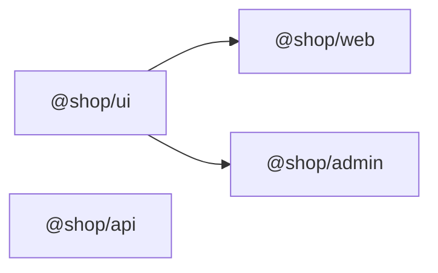

import { Aside, FileTree } from '@astrojs/starlight/components'
import RunPicker from '../../../components/demos/RunPicker.astro'

`vx run <task>` runs a task, and every task it needs first.

```sh
vx run build
```

This page follows one small shop through a day of runs. Each section
ends with something you can do that you could not before.

---

## Meet the shop

Four projects. The **web** store and the **admin** panel use a shared
**ui** kit. The **api** stands alone.

<FileTree>
- .vx/workspace.ts
- packages/
  - ui/ vx.config.ts, src/
  - web/ vx.config.ts, src/
  - admin/ vx.config.ts, src/
  - api/ vx.config.ts, src/
</FileTree>



An arrow reads "is used by". Every project declares the same three
tasks: `build` runs `vite build`, `test` runs `vitest run`, `lint` runs
`oxlint src`.

```ts title="packages/web/vx.config.ts" mark={6,13}
import { defineProject } from '@vzn/vx/config'

export default defineProject({
  tasks: {
    build: {
      dependsOn: ['^build'],
      exec: { command: 'vite build' },
      inputs: { files: ['src/**', 'vite.config.ts'] },
      outputs: { files: ['dist/**'] },
      cache: true,
    },
    test: {
      dependsOn: ['^build'],
      exec: { command: 'vitest run' },
      inputs: { files: ['src/**'] },
      outputs: { files: [] },
      cache: true,
    },
    lint: {
      exec: { command: 'oxlint src' },
      inputs: { files: ['src/**'] },
      outputs: { files: [] },
      cache: true,
    },
  },
})
```

`^build` means "first build the projects I use". That one line is why
`web` never builds against a stale `ui`. [Tasks](../tasks/) explains
every key.

---

## 1. Run one task

Stand in a project and name the task.

```sh
cd packages/web
vx run build
```

```ansi
┌─ @shop/web#build > $ vite build
vite v8.3.8 building client environment for production...
transforming...
✓ 2 modules transformed.
rendering chunks...
computing gzip size...
dist/index.js  0.04 kB │ gzip: 0.06 kB

✓ built in 27ms
└─ @shop/web#build ── (172ms) success

  Summary                                                                                                       vx 0.0.0
  projects  ▰▰▰▰▰▰▰▰▰▰▰▰▰▰▰▰▰▰▰▰▰▰▰▰▰▱▱▱▱▱▱▱▱▱▱▱▱▱▱▱▱▱▱▱▱▱▱▱▱▱
            2 in run · 4 total
  tasks     ▰▰▰▰▰▰▰▰▰▰▰▰▰▰▰▰▰▰▰▰▰▰▰▰▰▰▰▰▰▰▰▰▰▰▰▰▰▰▰▰▰▰▰▰▰▰▰▰▰▰
            2 success · 2 total
  cache     ▰▰▰▰▰▰▰▰▰▰▰▰▰▰▰▰▰▰▰▰▰▰▰▰▰▰▰▰▰▰▰▰▰▰▰▰▰▰▰▰▰▰▰▰▰▰▰▰▰▰
            local 2↑

  info      4 workers · local cache · run 01a209c1-2438-7500-bb1a-b5fb76f7f44b
  time      415ms · max 191ms · avg 182ms · min 172ms
```

Look at `2 in run`. You asked for one build and got two: `@shop/ui`
built first, because `web` waits on it. Only `web`'s log is shown; its
helpers run quietly unless they fail.

<Aside type="tip" title="You can now">
  Build any project, with everything it needs, from inside its folder.
</Aside>

---

## 2. Run it everywhere

From the workspace root, `--all` runs the task in every project that
declares it.

```sh
vx run build --all
```

```ansi
  Tasks     status  cache     ±usual    time   cpu    mem outputs  blocks worker         task                           
            success miss           —   221ms  107%  117MB     48B       0 local          @shop/api#build
            success miss           —   224ms  103%  113MB     50B       0 local          @shop/admin#build

  Summary                                                                                                       vx 0.0.0
  projects  ▰▰▰▰▰▰▰▰▰▰▰▰▰▰▰▰▰▰▰▰▰▰▰▰▰▰▰▰▰▰▰▰▰▰▰▰▰▰▰▰▰▰▰▰▰▰▰▰▰▰
            4 in run · 4 total
  tasks     ▰▰▰▰▰▰▰▰▰▰▰▰▰▰▰▰▰▰▰▰▰▰▰▰▰▰▰▰▰▰▰▰▰▰▰▰▰▰▰▰▰▰▰▰▰▰▰▰▰▰
            4 success · 4 total
  cache     ▰▰▰▰▰▰▰▰▰▰▰▰▰▰▰▰▰▰▰▰▰▰▰▰▰▰▰▰▰▰▰▰▰▰▰▰▰▰▰▰▰▰▰▰▰▰▰▰▰▰
            local 2✓ 2↑

  info      4 workers · local cache · run 01a209c1-26ae-7182-827a-7fe570c01226
  time      305ms · max 224ms · avg 223ms · min 221ms
```

Only `api` and `admin` ran. `ui` and `web` were built a minute ago, so
the `cache` line counts them as `2✓`. Run the same command again:

```ansi
  Summary                                                                                                       vx 0.0.0
  projects  ▰▰▰▰▰▰▰▰▰▰▰▰▰▰▰▰▰▰▰▰▰▰▰▰▰▰▰▰▰▰▰▰▰▰▰▰▰▰▰▰▰▰▰▰▰▰▰▰▰▰
            4 in run · 4 total
  tasks     ▰▰▰▰▰▰▰▰▰▰▰▰▰▰▰▰▰▰▰▰▰▰▰▰▰▰▰▰▰▰▰▰▰▰▰▰▰▰▰▰▰▰▰▰▰▰▰▰▰▰
            4 success · 4 total
  cache     ▰▰▰▰▰▰▰▰▰▰▰▰▰▰▰▰▰▰▰▰▰▰▰▰▰▰▰▰▰▰▰▰▰▰▰▰▰▰▰▰▰▰▰▰▰▰▰▰▰▰
            local 4✓

  info      4 workers · local cache · run 01a209c1-2898-70a6-bc78-28e577775b0d
  time      20ms
```

Nothing changed, so nothing ran: `4✓` in 20 ms. Now delete every `dist`
folder and run it once more:

```sh
rm -rf packages/*/dist
vx run build --all
```

```ansi
  Summary                                                                                                       vx 0.0.0
  projects  ▰▰▰▰▰▰▰▰▰▰▰▰▰▰▰▰▰▰▰▰▰▰▰▰▰▰▰▰▰▰▰▰▰▰▰▰▰▰▰▰▰▰▰▰▰▰▰▰▰▰
            4 in run · 4 total
  tasks     ▰▰▰▰▰▰▰▰▰▰▰▰▰▰▰▰▰▰▰▰▰▰▰▰▰▰▰▰▰▰▰▰▰▰▰▰▰▰▰▰▰▰▰▰▰▰▰▰▰▰
            4 success · 4 total
  cache     ▰▰▰▰▰▰▰▰▰▰▰▰▰▰▰▰▰▰▰▰▰▰▰▰▰▰▰▰▰▰▰▰▰▰▰▰▰▰▰▰▰▰▰▰▰▰▰▰▰▰
            local 4↓

  info      4 workers · local cache · run 01a209c3-7ea7-750c-82f9-7c1afe5b4fc4
  time      26ms
```

`4↓`: vx put each `dist` back from its cache instead of building.
The `cache` line always tells you which of these happened:

| Mark | Means | The task |
| ---- | ----- | -------- |
| <span style="color:var(--vx-ok)">`✓`</span> | up to date: its outputs are already on disk | did not run |
| <span style="color:var(--vx-link)">`↓`</span> | restored from the cache | did not run |
| <span style="color:var(--vx-link)">`↑`</span> | ran, then saved to the cache | ran |
| `∅` | ran with no cache | ran |

<Aside type="tip" title="You can now">
  Run a task across the whole workspace, and read from one line what
  ran and what was skipped. Why it skips: [Caching](../caching/).
</Aside>

---

## 3. Choose the projects

`--filter` picks projects by name, by folder, or by where they sit in
the graph. Pick a task and a filter below and watch what lights up.

<RunPicker />

The filters you will use most:

| Filter | Picks |
| ------ | ----- |
| `@shop/web` | that project |
| `web` | the same: the scope may be left out |
| `@shop/*` | every project whose name matches |
| `./packages/api` | the project in that folder |
| `@shop/web...` | `web` and everything it uses |
| `...@shop/ui` | `ui` and everything that uses it |
| `!@shop/api` | everything except `api` |

Here is the second-to-last one for real. Every project that uses `ui`
tests against its fresh build:

```sh
vx run test --filter '...@shop/ui' --dry
```

```ansi
  Plan 4    status  cache      usual    time   cpu    mem outputs  blocks worker         task                           
            run     miss           —       —     —      —       —       0 local          @shop/admin#test
            cached  local          —       —     —      —       —       2 local          @shop/ui#build
            run     miss           —       —     —      —       —       0 local          @shop/ui#test
            run     miss           —       —     —      —       —       0 local          @shop/web#test

  tasks     4 planned · 1 cache hit (1 local) · 3 would run
```

Every filter must match a project. A typo stops the run before anything
starts, and `fix` names what you meant:

```sh
vx run test --filter @shop/wbe
```

```ansi
✗ vx run  no projects matched filter(s): "@shop/wbe"

  fix  @shop/web
```

<details>
<summary><strong>Dig deeper:</strong> every filter form, and how filters combine</summary>

| Form | Picks |
| ---- | ----- |
| `<name>` | projects by name; `*` matches anything, `/` included |
| `./<dir>` or `{<dir>}` | the project in that folder, or every project under it |
| `./<glob>` | projects whose folder matches: `./packages/*` |
| `<name>{<dir>}` | projects matching the name inside that folder |
| `.` | the root project (else every project) |
| `//` | the root project alone |
| `tag:<name>` | projects whose config `tags` match |
| `<f>...` | the match and everything it uses |
| `...<f>` | the match and everything that uses it |
| `<f>^...` | only what the match uses, not the match |
| `...^<f>` | only what uses the match, not the match |
| `...<f>...` | the match, what uses it, and what all of those use |
| `[<ref>]` | projects with files changed since a git ref: `[origin/main]` |
| `<f>[<ref>]` | the match, if it changed since the ref |
| `<f>...[<ref>]` | the match, if it or anything it uses changed |
| `!<f>` | remove these from the selection |

Filters combine in a fixed order:

1. Every include is added up: `--filter web --filter api` runs both.
2. Then every `!` removes from the result, wherever it was written.
3. A run with only `!` filters starts from every project.

"Uses" comes from two places: your [lockfile plugin](../lockfiles/),
which reads what the package manager installed, and any cross-project
`dependsOn` such as `'api#build'`.

Full grammar and error messages: [`--filter`](../../cli/run/#filter-dsl---filter).

</details>

<Aside type="tip" title="You can now">
  Run a task in exactly the projects you mean, by name, folder or
  neighbours.
</Aside>

---

## 4. Run only what changed

You open a branch and edit `ui` and `api`. `--affected` runs only the
tasks your change can reach. Add `--dry` to see the list first:

```sh
vx run test --affected=main --dry
```

```ansi
  Plan 5    status  cache      usual    time   cpu    mem outputs  blocks worker         task                           
            run     miss           —       —     —      —       —       0 local          @shop/admin#test  affected: packages/ui/src/index.ts changed (an input), via @shop/ui#build
            run     miss      ~191ms       —     —      —       —       2 local          @shop/ui#build
            run     miss      ~421ms       —     —      —       —       0 local          @shop/api#test  affected: packages/api/src/index.ts changed (an input)
            run     miss           —       —     —      —       —       0 local          @shop/ui#test  affected: packages/ui/src/index.ts changed (an input)
            run     miss           —       —     —      —       —       0 local          @shop/web#test  affected: packages/ui/src/index.ts changed (an input), via @shop/ui#build

  tasks      5 planned · 5 would run
  predicted  ~421ms wall · ~612ms total execution · 3 tasks never timed (+?)
```

Every row says why it is there. `admin#test` runs because `ui` changed
and it waits on `ui#build`. Try **`--affected`** in the picker above,
then switch the task to `lint`.

`lint` waits on nothing, so a change in `ui` reaches only `ui#lint`.
A change travels only along `dependsOn`.

<details>
<summary><strong>Dig deeper:</strong> which commit <code>--affected</code> compares with</summary>

Bare `--affected` picks its base, the first that applies:

1. `VX_AFFECTED_BASE`, if set.
2. A plugin's base, such as the pull request's base branch on GitHub.
3. The merge base of `HEAD` and `origin/<baseBranch>`.

`baseBranch` is `origin/HEAD`'s branch, else `main`, else `master`.
Set it in [`.vx/workspace.ts`](../workspace/) or with `VX_BASE_BRANCH`.

- Comparing from the **merge base** means you see only your branch's
  changes, never what others merged to `main` since.
- On the base branch itself there is nothing to compare with, so vx
  refuses. Use `--all`: the cache already skips what did not change.
- A shallow CI clone is fine. vx fetches the history it needs, no file
  contents.
- Write the value with `=`: `--affected=origin/main`. In
  `--affected main`, `main` is read as a task name.

What marks a task: a changed file in its `inputs`, a changed
`vx.config.ts` (all of the project's tasks), or a changed file no task
of its project declares. Full rules: [`--affected`](../../cli/run/#--affectedbase).

</details>

<Aside type="tip" title="You can now">
  Test only what a branch touched, and see why each task made the cut.
</Aside>

---

## 5. Several tasks in one run

Name as many tasks as you like. They share one graph, so nothing runs
twice and independent tasks run side by side.

```sh
vx run lint test --filter @shop/api
```

```ansi
  Tasks     status  cache     ±usual    time   cpu    mem outputs  blocks worker         task                           
            success miss           —    59ms   93%   78MB      0B       0 local          @shop/api#lint
            success miss           —   421ms  107%  110MB      0B       0 local          @shop/api#test

  Summary                                                                                                       vx 0.0.0
  projects  ▰▰▰▰▰▰▰▰▰▰▰▰▰▱▱▱▱▱▱▱▱▱▱▱▱▱▱▱▱▱▱▱▱▱▱▱▱▱▱▱▱▱▱▱▱▱▱▱▱▱
            1 in run · 4 total
  tasks     ▰▰▰▰▰▰▰▰▰▰▰▰▰▰▰▰▰▰▰▰▰▰▰▰▰▰▰▰▰▰▰▰▰▰▰▰▰▰▰▰▰▰▰▰▰▰▰▰▰▰
            2 success · 2 total
  cache     ▰▰▰▰▰▰▰▰▰▰▰▰▰▰▰▰▰▰▰▰▰▰▰▰▰▰▰▰▰▰▰▰▰▰▰▰▰▰▰▰▰▰▰▰▰▰▰▰▰▰
            local 2↑

  info      4 workers · local cache · run 01a209c1-2bec-7432-84e9-38a821dd7d50
  time      455ms · max 421ms · avg 240ms · min 59ms
```

Two more ways to name tasks, from anywhere in the workspace:

```sh
vx run @shop/api#test       # one project's task, exactly
vx run //#build             # the root project's task
```

<Aside type="tip" title="You can now">
  Run a whole check (lint, test, build) as one command.
</Aside>

---

## 6. Pass flags to the tool

Everything after `--` goes to the task's command, unchanged.

```sh
vx run @shop/web#test -- --reporter=dot
```

```ansi
┌─ @shop/web#test > $ vitest run --reporter=dot

·

 Test Files  1 passed (1)
      Tests  1 passed (1)
   Start at  18:53:05
   Duration  149ms (import 49%, transform 24%, worker 15%, tests 12%, environment 1%)

└─ @shop/web#test ── (454ms) success

  Summary                                                                                                       vx 0.0.0
  projects  ▰▰▰▰▰▰▰▰▰▰▰▰▰▰▰▰▰▰▰▰▰▰▰▰▰▱▱▱▱▱▱▱▱▱▱▱▱▱▱▱▱▱▱▱▱▱▱▱▱▱
            2 in run · 4 total
  tasks     ▰▰▰▰▰▰▰▰▰▰▰▰▰▰▰▰▰▰▰▰▰▰▰▰▰▰▰▰▰▰▰▰▰▰▰▰▰▰▰▰▰▰▰▰▰▰▰▰▰▰
            2 success · 2 total
  cache     ▰▰▰▰▰▰▰▰▰▰▰▰▰▰▰▰▰▰▰▰▰▰▰▰▰▰▰▰▰▰▰▰▰▰▰▰▰▰▰▰▰▰▰▰▰▰▰▰▰▰
            local 1✓ 1↑

  info      4 workers · local cache · run 01a209c1-2e64-70ca-9a2a-42a4f9159a6a
  time      514ms
```

The first line shows what ran: `vitest run --reporter=dot`.

<Aside type="note">
  The forwarded words are part of the task's cache key. Different flags,
  different result, so vx never replays a run made with other flags.
</Aside>

Forwarding needs one task in one project. vx will not guess which
command a flag was meant for:

```sh
vx run test --all -- --bail
```

```ansi
✗ vx run  forwarded args (after --) go to one task in one project, and this run asks for 4: @shop/admin#test, @shop/api#test, @shop/ui#test, …; run that task alone, e.g. vx run @shop/admin#test -- …
```

vx has no short flags, so a `-t` before `--` is caught, and `fix` shows
where it goes:

```sh
vx run test -t adds --filter @shop/api
```

```ansi
✗ vx run  unknown flag: -t

  see vx run --help

  fix  vx run test --filter @shop/api -- -t adds
```

<details>
<summary><strong>Dig deeper:</strong> where forwarded words land</summary>

- They are shell-quoted, then added to the end of the command's last
  line.
- A trailing `;` or `&` stays last: the words go before it.
- In a compound command (`(cd web && vite)`, `if …; fi`) they go to its
  last command, where the shell still reads arguments.
- Another tool's flag name is hinted: `-j` and `--parallel` hint
  `--concurrency`; `-F` and `--scope` hint `--filter`.

Full rules: [argument forwarding](../../cli/run/#argument-forwarding---).

</details>

<Aside type="tip" title="You can now">
  Hand any flag to vite, vitest or oxlint through vx.
</Aside>

---

## 7. See the plan first

You edit `ui` again. Before running, ask what would happen:

```sh
vx run build --all --dry
```

```ansi
  Plan 4    status  cache      usual    time   cpu    mem outputs  blocks worker         task                           
            run     miss      ~224ms       —     —      —       —       0 local          @shop/admin#build
            run     miss      ~191ms       —     —      —       —       2 local          @shop/ui#build
            cached  local          —       —     —      —       —       0 local          @shop/api#build
            run     miss      ~172ms       —     —      —       —       0 local          @shop/web#build

  tasks      4 planned · 1 cache hit (1 local) · 3 would run
  predicted  ~415ms wall · ~587ms total execution
```

Nothing ran. Read it row by row:

- `api#build` is `cached local`: it comes from the cache, since `api`
  did not change.
- The other three `run`: `ui` changed, and `web` and `admin` build on it.
- `usual` is how long the task took last time; `blocks 2` means two
  tasks wait on `ui#build`.
- `predicted` adds it up: about 415 ms if you run it now.

`--dry=json` prints the same plan for scripts. Paste it into the
[graph explorer](../graph-explorer/) to browse it.

<Aside type="tip" title="You can now">
  Know what a run will cost before you start it.
</Aside>

---

## 8. Tune the run

Every `vx run` flag, by what it changes. Most also have a setting in
[`.vx/workspace.ts`](../workspace/) and a `VX_*` variable; the flag
wins, then the variable, then the setting.

**What runs**

| Flag | Does | Default |
| ---- | ---- | ------- |
| `--all` | every project that declares the task | off: the project you are in |
| `--filter <f>` | projects the filter picks; repeat it to add more | none |
| `--affected[=<ref>]` | the tasks a change since `<ref>` reaches | off |
| `--exclude-dependencies[=<names>]` | skip `dependsOn`: all of it, or only the named tasks | off |

**Cache**

| Flag | Does | Default |
| ---- | ---- | ------- |
| `--no-cache` | no cache reads or writes; outputs are left alone | off |
| `--force` | run every task, then save over the cache's entry | off |
| `--cache-policy <spec>` | reads and writes per cache: `local:rw,remote:r` | every cache reads and writes |
| `--cache-dir <path>` | where the local cache lives | `.vx/cache`, entries in `~/.vx/<id>/cache` |
| `--cache-download <mode>` | `all`, `toplevel` or `none`: which remotely run outputs come home | `all` |
| `--cache-concurrency-download <n>` | remote downloads at once | 64 to 96, by cores |
| `--cache-concurrency-upload <n>` | uploads at once, per remote | 64 to 96, by cores |
| `--cache-concurrency-restore <n>` | local hits restored at once | twice `--concurrency` |

**Speed and order**

| Flag | Does | Default |
| ---- | ---- | ------- |
| `--concurrency <n>` | at most `n` tasks at once; `50%` is half the cores | every core you may use |
| `--schedule <rule>` | which ready task starts first: `most-work`, `critical-path`, `direct-dependents`, `ready-order` | `most-work` |

**Failures and limits**

| Flag | Does | Default |
| ---- | ---- | ------- |
| `--fail-fast` | stop everything at the first failure | off: a failure skips only what waits on it |
| `--retries <n>` | re-run a failed task up to `n` more times | `0` |
| `--timeout <time>` | a time limit for tasks without their own: `30s`, `10m` | none |

**Output and records**

| Flag | Does | Default |
| ---- | ---- | ------- |
| `--output-logs <mode>` | `full`, `errors-only`, `hash-only` or `none` | `errors-only` on CI |
| `--verbosity <n>` | `1` adds a table of every task after the run | `0` |
| `--dry[=pretty\|json]` | print the plan, run nothing | off |
| `--profile[=<file>]` | write a Chrome trace of the run | off (`profile.json`) |
| `--branch <name>` | the branch the run's history is filed under | git's branch |

<details>
<summary><strong>Dig deeper:</strong> flag rules, exit codes</summary>

- Flags with an optional value take it with `=` only:
  `--affected=main`, `--dry=json`, `--profile=run.json`.
- A flag given twice keeps the last value, so a flag added after a
  script's own wins.
- `--no-cache` beats `--force`. Neither changes a cache key, and nor do
  `--retries`, `--timeout` and `--cache-download`.
- Numbers are plain: `--concurrency 0x10` is refused. A time needs its
  unit: `--timeout 500` is refused, `500ms` is not.
- An unknown flag is refused with the nearest real one:
  `--concurency` shows `fix --concurrency`.

| Exit code | When |
| --------- | ---- |
| `0` | every task passed or came from the cache |
| `1` | a task failed or was skipped, or the command was wrong |
| `130` | you pressed Ctrl-C (`143` for SIGTERM, `129` for SIGHUP) |

On a failure: [Stop at the first failure](../running/stop-at-the-first-failure/).
Every detail: [`vx run`](../../cli/run/).

</details>

<Aside type="tip" title="You can now">
  Shape any run: what it touches, how fast it goes, and when it stops.
</Aside>

---

## 9. Forgot a task's name?

Type `vx run` alone in a terminal. vx lists every task with its
`description` and runs the number you pick. Outside a terminal, such as
in a script, it names the tasks instead:

```sh
cd packages/web
vx run < /dev/null
```

```ansi
✗ vx run  missing task name (stdin is not a TTY, so no picker; tasks here: build, lint, test)

  see vx run --help
```

---

You can now run any task, anywhere in the workspace, and predict what
it will do. Next, see why the third run took 20 ms:
[Caching](../caching/).
