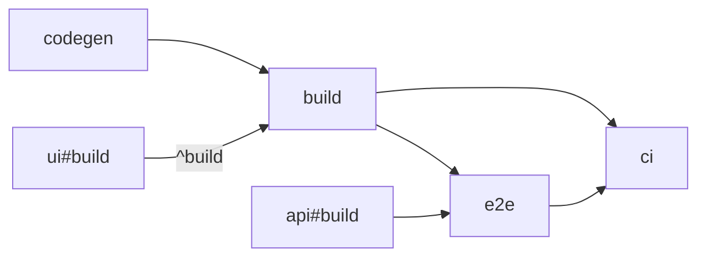

import { Aside } from '@astrojs/starlight/components'
import GraphExplorer from '../../../components/demos/GraphExplorer.astro'

A task is one shell command in a project's `vx.config.ts`. `dependsOn`
says what must finish first; vx runs the rest in parallel.

```ts title="packages/app/vx.config.ts"
import { defineProject } from '@vzn/vx/config'

export default defineProject({
  tasks: {
    codegen: {
      exec: { command: 'graphql-codegen' },
      inputs: { files: ['schema.graphql'] }, cache: { outputs: { files: ['src/gen/**'] } },
    },
    build: {
      description: 'compile TypeScript to dist/',
      dependsOn: ['codegen', '^build'],
      exec: { command: 'tsc -b' },
      // codegen's output reaches this key through codegen's own key; a key
      // that read it could not be known until codegen ran, so vx refuses it.
      inputs: { files: ['src/**', '!src/gen/**'] }, cache: { outputs: { files: ['dist/**'] } },
    },
    e2e: {
      dependsOn: ['build', 'api#build'],
      exec: { command: 'playwright test', timeout: '10m', retries: 1 },
    },
    // A group: no command, it only runs its dependencies.
    ci: { dependsOn: ['build', 'e2e'] },
  },
})
```



---

## `dependsOn`

| `dependsOn`   | Runs first                                                        |
| ------------- | ----------------------------------------------------------------- |
| `'build'`     | `build` in this package                                           |
| `'^build'`    | `build` in each package this one depends on ([a lockfile plugin's edges](../lockfiles/)) |
| `'api#build'` | `build` in the `api` package                                      |
| `'build.*'`   | every task in this package whose name matches                     |

A task-name pattern is allowed: `dependsOn: ['build.*']`, or `'^build.*'`.
Bare wildcards and negation (`*`, `!task`) are not.
A cycle or a missing `'pkg#task'` is an error.

---

## Groups

A task with no `exec` is a group: it only runs its dependencies.

```ts
ci: { dependsOn: ['build', 'e2e'] },
```

<Aside title="A package with no build">
  A package that declares no `build` gets a default one: a group behind
  `^build`, keyed on all its files, so editing a package consumed as source
  re-runs its dependents. `vx show` lists it as a group.
</Aside>

---

## When a task fails

| Flag | vx |
| ---------------------------- | --------------------------------------------------------- |
| `--continue=deps-ok` (default) | skips its transitive dependents and runs the rest       |
| `--continue=never`           | stops at the first failure                                |
| `--continue=always`          | runs the dependents, but saves none of them               |

```sh
vx run test --all --continue=never
```

---

## Explore your graph

See what each task waits on and what waits on it, in your own repo:

```sh
vx run build --all --dry=json > plan.json
```

Drop `plan.json` below, or paste it, then type a task. Nothing is uploaded.

<GraphExplorer />

---

<details>
<summary>Every <code>exec</code> field</summary>

| Field             | Does                                                          |
| ----------------- | ------------------------------------------------------------- |
| `exec.command`    | the one shell command, run in the package's directory (join steps with `&&`) |
| `exec.env`        | what the command sees ([Environment variables](../environment-variables/))       |
| `exec.timeout`    | kill the task after this long                                 |
| `exec.retries`    | re-run a failed task this many times                          |
| `exec.persistent` | a server or watcher that does not exit ([Dev servers](../dev-servers/))  |
| `exec.sandbox`    | only the declared files and network ([Sandboxing](../../docs/sandboxing/)) |
| `exec.interactive` | reads the terminal: a prompt, a REPL, a TUI; runs alone, never cached |
| `exec.platforms`  | the machines it runs on, such as `['darwin-arm64']`; elsewhere skipped, on CI refused |
| `exec.remote`     | `false` keeps it here; `'only'` for a remote pool ([Remote execution](../../docs/remote-execution/)) |

`exec.remote` is the one `exec` field left out of the key: where a task
ran says nothing about what it made. Every other field is in the key, so
editing even `description` re-runs the task once.

</details>

See [Caching](../caching/) to skip a task whose inputs did not change, and [vx.config.ts](../../schema/) for every field.
