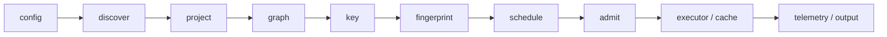

import { Steps, Aside, CardGrid, LinkCard } from '@astrojs/starlight/components'

Change every run from one place: add tasks, key material, a cache, an
exporter or a CLI verb. A plugin fills one or more stages of the run;
everything else stays core's.



## Write one

<Steps>

1. **Start from a template**

   `vx init --plugin <seam>` writes one, with its test, into your
   workspace. A runnable plugin for each of nine seams, each held by a test
   that runs it, is in
   [`private/vx-plugin-examples`](https://github.com/vznjs/vx/tree/main/private/vx-plugin-examples).

2. **Fill the hooks you need**

   A plugin is a function that returns `definePlugin(import.meta, hooks)`.
   Its name is its package's name. An unfilled hook costs nothing.

3. **Declare it**

   In `.vx/workspace.ts`: `plugins: [typecheck()]`. `vx info` lists it
   with its hooks.

4. **Test it**

   Call `run()` from `@vzn/vx` on a throwaway workspace.

</Steps>

This one gives every project with a `tsconfig.json` a `typecheck` task:

```ts
import path from 'node:path'
import { definePlugin, type VxPlugin } from '@vzn/vx'

export function typecheck(): VxPlugin {
  return definePlugin(import.meta, {
    async project(config, ctx) {
      if (!(await Bun.file(path.join(ctx.dir, 'tsconfig.json')).exists())) return
      config.tasks ??= {}
      config.tasks['typecheck'] ??= {
        exec: { command: 'tsc --noEmit' },
        inputs: { files: ['src/**', 'tsconfig.json'] }, cache: { outputs: { files: [] } },
      }
    },
  })
}
```

## The hooks

Plugins are asked in the order you list them. What every plugin declines
runs and is stored on this machine.

| Stage       | Hook                   | Decides                                                   |
| ----------- | ---------------------- | --------------------------------------------------------- |
| config      | `config(ws, ctx)`      | the workspace config, before it is used                   |
| discover | `discover(ctx)` | which directories are projects, and their edges |
| project     | `project(config, ctx)` | a project's tasks: add, remove, rewrite                   |
| graph       | `graph(nodes, ctx)`    | the run's edges                                           |
| key         | `key(task, ctx)`       | extra cache-key material, named in `vx why`               |
| fingerprint | `fingerprint`          | a root file it keys itself, such as a lockfile            |
| schedule    | `schedule(nodes, ctx)` | which ready task runs first                               |
| admit       | `admit(task, ctx)`     | whether a ready task starts now, beside what runs here    |
| execute     | `executor(ctx)`        | where one task's command runs                             |
| store       | `cache(ctx)`           | where artifacts live                                      |
| observe     | `telemetry(ctx)`       | where run records go; it can never change the run         |
| render | `output(ctx)` | who draws the terminal: a `Logger` in place of vx's own |
| setup       | `setup(ctx)`           | once per run, before the first task                       |
| cli         | `commands`             | which verbs `vx` has                                      |
| teardown    | `teardown()`           | flush and close at the end of the run                     |

```ts
import type { VxPlugin } from '@vzn/vx'

interface VxPlugin {
  readonly name: string // your package's name: definePlugin reads it
  config?(workspace, ctx): void
  discover?(ctx): { dir; name?; deps?; reach? }[] // projects and their edges
  project?(config, ctx): void
  graph?(nodes, ctx): void
  key?(task, ctx): Record<string, string>
  fingerprint?: { files; affected(change, ctx) }
  schedule?(nodes, ctx): Map<string, number>
  admit?(task, ctx): boolean
  executor?(ctx): TaskExecutor | undefined
  cache?(ctx): RemoteCacheLayer | undefined
  telemetry?(ctx): TelemetrySink | TelemetrySink[] | undefined
  output?(ctx): Logger | undefined // draw the run yourself
  commands?: { [verb]: { description: string; run(argv, ctx): number | Promise<number> } }
  setup?(ctx): void | Promise<void>
  teardown?(run?: RunReport): void | Promise<void>
}
```

## Workspace and projects

`config` edits the workspace config before vx reads it. Here, two
workers on CI:

```ts
import { definePlugin, type VxPlugin } from '@vzn/vx'

export function ciConcurrency(): VxPlugin {
  return definePlugin(import.meta, {
    config(workspace) {
      if (process.env.CI) workspace.run = { ...workspace.run, concurrency: 2 }
    },
  })
}
```

`discover` makes a directory with no `vx.config.ts` a project; its
tasks come from a `project` hook:

```ts
import { definePlugin, type VxPlugin } from '@vzn/vx'

export function scriptsProject(): VxPlugin {
  return definePlugin(import.meta, {
    discover: () => [{ dir: 'scripts', name: 'scripts' }],
  })
}
```

An entry also gives a project edges. `deps` orders `^build` and reaches
`--filter app...` and `--affected`; `reach` only reaches. vx reads no
edges from a `package.json`, so with no plugin returning `deps`, a
`^build` is refused:

```ts
discover: () => [{ dir: 'apps/web', deps: ['packages/ui'], reach: ['packages/config'] }]
```

`fingerprint` claims a root file. An edit to it asks `affected` which
projects it touches (`undefined`: all). Fold its bytes into the key with
`key`:

```ts
import { readFileSync } from 'node:fs'
import path from 'node:path'
import { definePlugin, type VxPlugin } from '@vzn/vx'

export function toolVersions(): VxPlugin {
  const file = '.tool-versions'
  return definePlugin(import.meta, {
    key: (_task, ctx) => ({ [file]: readFileSync(path.join(ctx.workspaceRoot, file), 'utf8') }),
    fingerprint: { files: [file], affected: () => undefined },
  })
}
```

[`@vzn/vx-lockfile`](../../docs/lockfiles/) claims a lockfile this way.

## Keys and order

`key` adds what your inputs cannot see, like a tool version:

```ts
import { definePlugin, type VxPlugin } from '@vzn/vx'

export function nodeMajor(): VxPlugin {
  const major = process.versions.node.split('.')[0]!
  return definePlugin(import.meta, { key: () => ({ 'node-major': major }) })
}
```

`admit` holds a ready task back. Here, one e2e suite at a time:

```ts
import { definePlugin, type VxPlugin } from '@vzn/vx'

export function oneDatabase(): VxPlugin {
  return definePlugin(import.meta, {
    admit(task, ctx) {
      if (!task.id.endsWith('#e2e')) return true
      return !ctx.running.some((r) => r.id.endsWith('#e2e'))
    },
  })
}
```

`schedule` ranks ready tasks; weights that need a fetch go to
`ctx.refine(weights)` when they arrive. This one learns from run history:

```ts
import { defineWorkspace } from '@vzn/vx/config'
import { scheduleHistoryPlugin } from '@vzn/vx-schedule-history'

export default defineWorkspace({ plugins: [scheduleHistoryPlugin()] })
```

On CI it keeps timings in the remote cache; with none,
`scheduleHistoryPlugin({ file: '.vx-timings.json' })` keeps them in a file
([post](../../blog/ci-timings-file/)).

## Setup and teardown

`setup` runs before the first task; a throw stops the run. `ctx.on`
subscribes to run events. `teardown` runs at the end, even on Ctrl-C:

```ts
import { definePlugin, type VxPlugin } from '@vzn/vx'

export function taskLog(): VxPlugin {
  const lines: string[] = []
  return definePlugin(import.meta, {
    setup(ctx) {
      ctx.on('onTaskComplete', (task, outcome) => {
        lines.push(`${task.id} ${outcome.status}`)
      })
    },
    teardown() {
      console.log(lines.join('\n'))
    },
  })
}
```

`ctx.cache` keeps your plugin's own small entries (`get`, `put`, `has`,
`hasMany`) in the local cache and every remote. An entry is written once,
at most 1 MiB; a failure is an empty answer. `ctx.ci` and `ctx.branch`
say where the run is.

### Secrets

`ctx.secret({ key, prompt })` reads a token from the OS keychain. When
it is missing and a terminal is attached (not on CI), it asks with the
input hidden and saves the answer. Otherwise it rejects, and
`isSecretUnavailable(err)` is true. Check your env var first.
`ctx.forgetSecret({ key })` drops a token your server refused.

```ts
import { definePlugin, isSecretUnavailable, type VxPlugin } from '@vzn/vx'

export function acme(): VxPlugin {
  let token: string | undefined
  return definePlugin(import.meta, {
    async setup(ctx) {
      token =
        process.env.ACME_TOKEN ||
        (await ctx.secret({ key: 'acme', prompt: 'Acme token: ' }).catch((err: unknown) => {
          if (!isSecretUnavailable(err)) throw err
          ctx.warn(`acme: no token (${err.reason}); set ACME_TOKEN`)
          return undefined
        }))
    },
    teardown() {
      token = undefined
    },
  })
}
```

`teardown(run)` gets the run's report: every task with its status, key,
and the log and outputs vx kept in the remote. `ctx.cache.getRun(name)`
reads them back. See the [API](../../api/).

## A verb and a sink

`commands` adds a verb. A telemetry sink gets each run's summary; do
network I/O in `flush()`, which vx awaits for up to 3 s.

```ts
import { Cache, definePlugin, type VxPlugin } from '@vzn/vx'

export function mcp(): VxPlugin {
  return definePlugin(import.meta, {
    commands: {
      mcp: {
        description: 'serve run history to an AI agent over stdio',
        async run(argv, ctx) {
          const db = Cache.inspect(ctx.cacheDir).dbHandle() // read-only: never resets the index
          void argv
          void db
          return 0 // the exit code
        },
      },
    },
  })
}
```

```ts
import { definePlugin, defineWorkspace, type VxPlugin } from '@vzn/vx'

function hello(): VxPlugin {
  return definePlugin(import.meta, {
    telemetry() {
      return {
        onRunSummary(summary) {
          const { taskCount, failedCount, hitCount, totalDurationMs } = summary
          console.log(`${taskCount} tasks · ${failedCount} failed · ${hitCount} cached · ${totalDurationMs}ms`)
        },
      }
    },
  })
}

export default defineWorkspace({ plugins: [hello()] })
```

## Draw the terminal

`output` returns a `Logger` that gets every line vx would print. Decline
off a terminal so pipes, CI and agents read what they always did. A
`Logger` that throws hands the run back to vx's renderer.

```ts
import { definePlugin, type VxPlugin } from '@vzn/vx'

export function dots(): VxPlugin {
  return definePlugin(import.meta, {
    output(ctx) {
      if (!ctx.isTTY || ctx.ci) return undefined
      return {
        status: (line) => process.stdout.write(`${line}\n`),
        taskStdout: () => {},
        taskStderr: () => {},
        taskComplete: (_, outcome) => process.stdout.write(outcome.status === 'failed' ? 'F' : '.'),
      }
    },
  })
}
```

## Where a task runs

`executor` returns a `TaskExecutor`: a `name`, an optional `accepts`,
and `execute`, which runs one command. A task every executor declines
runs here. Stop on `req.signal` (Ctrl-C or `exec.timeout`), and stop the
shell's children too: core cannot reach them.

```ts
import { definePlugin, type ExecuteResult, type VxPlugin } from '@vzn/vx'

export function nice(): VxPlugin {
  return definePlugin(import.meta, {
    executor: () => ({
      name: 'nice',
      accepts: (task) => task.taskId.endsWith('#e2e'),
      async execute(req): Promise<ExecuteResult> {
        const started = performance.now()
        const child = Bun.spawn(['nice', 'sh', '-c', req.command, 'sh', ...req.forwardArgs], {
          cwd: req.cwd,
          env: { ...req.env, ...req.envDefine },
          stdout: 'pipe',
          stderr: 'pipe',
          detached: true, // its own process group, so a stop reaches what the shell starts
        })
        const stop = () => process.kill(-child.pid, 'SIGTERM')
        req.signal?.addEventListener('abort', stop, { once: true })
        const drain = async (from: ReadableStream<Uint8Array>, to: (s: string) => void) => {
          const text = new TextDecoder()
          let all = ''
          for await (const bytes of from) {
            const s = text.decode(bytes, { stream: true })
            to(s)
            all += s
          }
          return all
        }
        const [stdout, stderr] = await Promise.all([
          drain(child.stdout, req.onStdout),
          drain(child.stderr, req.onStderr),
        ])
        const exitCode = await child.exited
        return { exitCode, durationMs: performance.now() - started, stdout, stderr, violations: [] }
      },
    }),
  })
}
```

## Your own cache

Return core's `RemoteCacheLayer` from the `cache` hook: `has`, `get` and
`put`, plus an optional `hasMany`. `has` answers `null` for a key the
remote lacks, else what it knows: `{ size, durationMs }` or `{}`. Write
`hasMany` only when your wire answers many keys in one call. An entry is
immutable: a `put` of a key the remote holds keeps the stored bytes.

vx asks the local cache first, then each remote in `plugins` order, under
`--cache-policy`. A remote error is a miss and one warning. Core bounds
no call, so give every request a deadline:

```ts
import { definePlugin, defineWorkspace, type RemoteCacheLayer, type VxPlugin } from '@vzn/vx'

const deadline = () => AbortSignal.timeout(30_000) // core bounds no call

class AcmeRemote implements RemoteCacheLayer {
  constructor(readonly endpoint: string) {} // printed in warnings: no credentials in it
  async has(hash: string) {
    const res = await fetch(`${this.endpoint}/${hash}`, { method: 'HEAD', signal: deadline() })
    if (!res.ok) return null
    const size = Number(res.headers.get('content-length'))
    return Number.isFinite(size) ? { size } : {} // what restoring it downloads
  }
  async get(hash: string) {
    const res = await fetch(`${this.endpoint}/${hash}`, { signal: deadline() })
    if (res.status === 404) return null
    if (!res.ok) throw new Error(`HTTP ${res.status}`) // a throw is a miss
    return { body: res, durationMs: undefined } // streamed to disk
  }
  async put(hash: string, body: Blob) {
    if ((await this.has(hash)) !== null) return // an entry is immutable; this server would overwrite
    const res = await fetch(`${this.endpoint}/${hash}`, { method: 'PUT', body, signal: deadline() })
    if (!res.ok) throw new Error(`HTTP ${res.status}`) // fetch resolves on a 500
  }
}

function acmeCache(): VxPlugin {
  return definePlugin(import.meta, {
    cache() {
      const url = process.env.ACME_CACHE_URL
      if (!url) return undefined // decline: the local cache alone
      return new AcmeRemote(`${url}/artifacts`)
    },
  })
}

export default defineWorkspace({ plugins: [acmeCache()] })
```

A remote that needs a credential adds `open`, asked once per run before
the first task; a throw sits the remote out. `ctx.secret` works there.
An optional `lend` hands this run's own access (never a stored secret)
to a machine that runs its tasks elsewhere, such as a `@vzn/vx-dte` worker.

### Signed artifacts

A wrapper can make a shared cache trust its writers, not its store: it
hashes each download and fails it unless a trusted key signed it. A
failed body is a miss. Only main's CI holds the private key:

```ts
// signed-cache.ts
import { createHash, createPrivateKey, createPublicKey, sign, verify } from 'node:crypto'
import { definePlugin, type RemoteCacheLayer, type VxPlugin } from '@vzn/vx'

/** `remote`, but a download no trusted key signed is a miss, and uploads are signed. */
function signed(remote: RemoteCacheLayer, trustedPem: string, signingPem?: string): RemoteCacheLayer {
  const trusted = createPublicKey(trustedPem)
  const signer = signingPem ? createPrivateKey(signingPem) : undefined
  // The key is signed too, so a valid artifact cannot be replayed under another.
  const message = (hash: string, digest: string) => Buffer.from(`${hash}\0${digest}`)
  return {
    has: (hash) => remote.has(hash),
    async get(hash) {
      const [got, sig] = await Promise.all([remote.get(hash), remote.get(`${hash}.sig`)])
      if (got === null || sig === null) return null
      const signature = Buffer.from(await sig.body.arrayBuffer())
      const sha = createHash('sha256')
      const source = got.body instanceof Blob ? got.body.stream() : got.body.body!
      const body = source.pipeThrough(
        new TransformStream<Uint8Array, Uint8Array>({
          transform(chunk, out) {
            sha.update(chunk)
            out.enqueue(chunk)
          },
          flush(out) {
            const ok = verify(null, message(hash, sha.digest('hex')), trusted, signature)
            if (!ok) out.error(new Error(`${hash}: no trusted signature`))
          },
        }),
      )
      return { body: new Response(body), durationMs: got.durationMs }
    },
    async put(hash, body, meta) {
      if (signer === undefined) return // every reader would refuse it
      const digest = createHash('sha256').update(await body.bytes()).digest('hex')
      await remote.put(hash, body, meta)
      await remote.put(`${hash}.sig`, new Blob([sign(null, message(hash, digest), signer)]), meta)
    },
  }
}

export function signedCache(remote: RemoteCacheLayer, trustedPem: string): VxPlugin {
  return definePlugin(import.meta, {
    cache: () => signed(remote, trustedPem, process.env.CACHE_SIGNING_KEY),
  })
}
```

Declare `signedCache(new AcmeRemote(url), PUBLIC_KEY_PEM)` and set
`CACHE_SIGNING_KEY` only in main's CI. Make the pair with
`openssl genpkey -algorithm ed25519` and `openssl pkey -pubout`. `has()`
is unchecked, so `--dry` can predict a hit the run then misses.

## What core refuses

- A `cache` or `executor` hook that breaks its contract: the three `RemoteCacheLayer` methods, or `execute` and a `name`.
- A `name` on the hooks object: the name is the package's.
- A `config` or `project` edit the loader would refuse from a user.
- A verb that names a core verb, or that two packages both declare.

A sink, `ctx.on` handler or `admit` that throws is switched off for the
run with one warning. A verb that throws fails in one line.

## Plugins that ship

| Package                     | Hooks it fills                             |
| --------------------------- | ------------------------------------------ |
| [`@vzn/vx-reapi`](../../plugins/vx-reapi/)             | `cache`, `executor` ([CI and remote](../../docs/remote-cache/)) |
| [`@vzn/vx-migrate`](../../plugins/vx-migrate/)           | `config`, `discover`, `project`, `fingerprint` (`turbo()`, `nx()`), `cache` (`turboCache()`, `nxCache()`) ([Migrate](../migrate/)) |
| [`@vzn/vx-lockfile`](../../plugins/vx-lockfile/)          | `discover`, `project`, `fingerprint`, `key` ([Lockfiles](../../docs/lockfiles/)) |
| [`@vzn/vx-schedule-history`](../../plugins/vx-schedule-history/)  | `schedule`, `admit`, `commands`            |
| [`@vzn/vx-otel`](../../plugins/vx-otel/)              | `telemetry` ([below](#opentelemetry))      |
| [`@vzn/vx-ci`](../../plugins/vx-ci/)            | `config`, `telemetry`, `commands` ([GitHub Actions](../../docs/ci/#github-actions), [GitLab CI](../../docs/ci/#gitlab-ci)) |

One plugin can fill several: `@vzn/vx-schedule-history` fills three at once.

<Aside title="Published plugins">
  Each one's README is in the reference: [Plugins](../../plugins/vx-ci/).
</Aside>

## OpenTelemetry

`@vzn/vx-otel` exports every run as OTLP traces, metrics and logs, with no
OpenTelemetry SDK: one trace per run, one span per task. Install it
(`bun add -d @vzn/vx-otel`) and point it at your collector
(`OTEL_EXPORTER_OTLP_ENDPOINT=http://localhost:4318`). Without any
endpoint it declines; a signal's own endpoint alone exports that signal.

```ts
// .vx/workspace.ts
import { defineWorkspace } from '@vzn/vx/config'
import { otel } from '@vzn/vx-otel'

export default defineWorkspace({
  plugins: [otel({ serviceName: 'my-monorepo', headers: { authorization: 'Bearer …' } })],
})
```

| Option            | Env var                                | Default                 |
| ----------------- | -------------------------------------- | ----------------------- |
| `endpoint`        | `OTEL_EXPORTER_OTLP_ENDPOINT`          | none                    |
| `tracesEndpoint`  | `OTEL_EXPORTER_OTLP_TRACES_ENDPOINT`   | `<endpoint>/v1/traces`  |
| `metricsEndpoint` | `OTEL_EXPORTER_OTLP_METRICS_ENDPOINT`  | `<endpoint>/v1/metrics` |
| `logsEndpoint`    | `OTEL_EXPORTER_OTLP_LOGS_ENDPOINT`     | `<endpoint>/v1/logs`    |
| `serviceName`     | `OTEL_SERVICE_NAME`                    | `vx`                    |
| `headers`         | `OTEL_EXPORTER_OTLP_HEADERS` (`k=v,…`) | `{}`                    |
| `metrics`         | `OTEL_METRICS_EXPORTER=none` turns it off | `true`               |
| `logs`            | `OTEL_LOGS_EXPORTER=none` turns it off | `true`                  |
| `timeoutMs`       | `OTEL_EXPORTER_OTLP_TIMEOUT`           | `15000`                 |
| `compression`     | `OTEL_EXPORTER_OTLP_COMPRESSION` (and `_<SIGNAL>_`) | `'none'`   |
| `live`            | none: send each task as it ends        | `true`                  |

| Signal            | Carries                                                                                                   |
| ----------------- | --------------------------------------------------------------------------------------------------------- |
| `vx.run` span     | `vx.run.task_count`, `vx.run.failed_count`, `vx.run.aborted_count`, `vx.run.hit_local_count`, `vx.run.hit_remote_count`, `vx.run.up_to_date_count`, `vx.run.restored_local_count`, `vx.run.restored_remote_count`, `vx.run.exit_ok`, `vx.cache.upload.*` (remote uploads, once settled), `vx.workspace.id`, `vx.default_branch`, `vx.telemetry.schema` |
| `vx.task` span    | `vx.cache.source`, `vx.cache.restored` (on a hit), `vx.task.hash`, `vx.task.attempts`, `vx.task.blocked_by`, `vx.task.timed_out`, `vx.task.sandbox_violations`, `vx.task.not_ready`, `vx.task.command`, `vx.task.flaky.*`, `vx.cache.stored_*` (on a hit), `vx.task.admission_held_ms`, `vx.task.queued_ms`, `vx.task.input_files`, `vx.cache.miss.change_count` and `vx.cache.miss.changes` (what a miss's key changed since the last saved entry), `vx.cache.artifact_bytes`, `vx.cache.save_ms`, `vx.cache.fetch_ms`; links to the tasks it waited on; `vx.task.retry`, `vx.task.timeout` and `vx.sandbox.violation` events |
| a span per stage  | `startup`, `load configs`, `classify + probe`, `run graph`, … (the `VX_DEBUG_TIMING` stages), with `vx.stage.name` |
| metrics           | `vx.tasks.total`, `vx.tasks.failed`, `vx.tasks.cache_hits`, `vx.tasks.cache_restored`, `vx.tasks.cache_up_to_date`, `vx.run.duration_ms`, `vx.run.time_saved_ms` |
| metrics per task  | `vx.task.duration`, `vx.task.cpu_time`, `vx.task.peak_memory`, `vx.task.time_saved`, `vx.task.admission_held`, `vx.task.queued`, `vx.task.artifact_size`, `vx.task.cache_save`, `vx.task.cache_fetch` at its end; `vx.task.cpu_usage` and `vx.task.memory` each second while it runs; each point names its span as an exemplar |
| a log per task    | the task's output at its end, linked to its span; `vx.log.chars_full` says when it was cut               |
| every resource    | `service.instance.id` (the run id), `host.name`, `host.arch`, `os.type`, `vcs.ref.head.*`, `vcs.repository.*`, `vx.workspace.path` (the workspace root in its repository), and on CI `cicd.pipeline.run.url.full`, `cicd.pipeline.name`, `vcs.change.id` (the pull request), `vx.ci.job`, `vx.ci.attempt`: one key joins a run's traces, metrics and logs |

Each task is sent as it ends, so a dashboard follows a CI run live;
`live: false` sends it all at the end. A failed task's span is `ERROR`.
A failed or slow export warns, and the run still exits green.

To see it locally, run
[otel-desktop-viewer](https://github.com/CtrlSpice/otel-desktop-viewer):

```sh
brew tap ctrlspice/otel-desktop-viewer
brew install --cask otel-desktop-viewer
otel-desktop-viewer
OTEL_EXPORTER_OTLP_ENDPOINT=http://localhost:4318 vx run build --all
```

## Next

<CardGrid>
  <LinkCard title="@vzn/vx API" description="Every type a plugin sees." href="../../api/" />
  <LinkCard title="Plugin examples" description="One runnable plugin per seam, each with its test." href="https://github.com/vznjs/vx/tree/main/private/vx-plugin-examples" />
</CardGrid>
