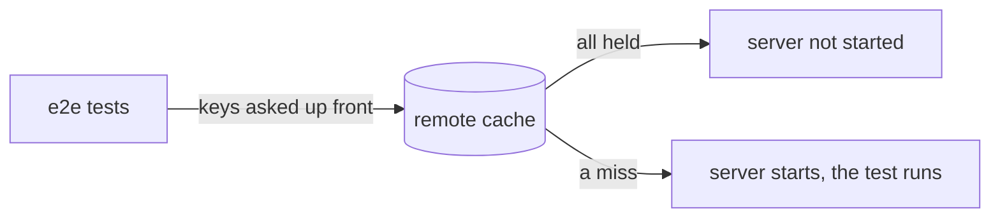

A setup step such as a migration or a seed can now be a dependency. A
dev server stays down when the remote cache already holds every test
that needs it. `vx init` gives `^build` its package edges in one step,
and `vx why` names the task that keeps a key from ever hitting. vx now
answers only its own flags and verbs.

This release is breaking: other runners' flag aliases and command hints
are gone. Read the [breaking changes](#breaking-changes) first.

Enjoy the release!

**In this release**

- [A setup step can be a dependency](#a-setup-step-can-be-a-dependency)
- [A server stays down behind remote hits](#a-server-stays-down-behind-remote-hits)
- [Package edges right after vx init](#package-edges-right-after-vx-init)
- [vx why names the task that stops a hit](#vx-why-names-the-task-that-stops-a-hit)
- [vx speaks only vx](#vx-speaks-only-vx)
- [Other noteworthy changes](#other-noteworthy-changes)
- [Breaking changes](#breaking-changes)

## A setup step can be a dependency

A persistent task that exited 0 before its `readyWhen` matched used to
fail, so a migration, a seed or `docker compose up --wait` could not sit
in front of the tests that need it.

Now a persistent task that exits 0 before it is ready counts as ready,
and its dependants run. One that exits non-zero still fails.

```ts
// vx.config.ts
import { defineProject } from '@vzn/vx/config'

export default defineProject({
  tasks: {
    db: {
      exec: {
        command: 'echo migrated',
        persistent: { readyWhen: 'listening' },
      },
    },
    test: {
      dependsOn: ['db'],
      exec: { command: 'echo tests passed' },
    },
  },
})
```

```txt frame="terminal"
$ vx run test
┌─ //#test > $ echo tests passed
tests passed
└─ //#test ── (3ms) success

  tasks     2 success · 2 total
```

See [persistent tasks](../../schema/exec/#persistent-optional).

## A server stays down behind remote hits

`vx run e2e` already left the dev server down when every test it serves
was a local hit. On a fresh CI runner the hits come from the remote, so
the server started anyway.

Now vx asks the remote about those tests first. When it holds them all,
the server never starts; at the first miss it starts, and that test runs
once the server is ready.



`vx run --dry` marks such a server `not started`.

## Package edges right after vx init

In a monorepo with a lockfile, `vx init` declared no plugin, so the
first `dependsOn: ['^build']` was refused at `vx lock` with "needs
project edges".

Init now declares the plugin the root lockfile calls for (`bun()`,
`pnpm()`, `yarn()` or `npm()`) and installs `@vzn/vx-lockfile` beside
`@vzn/vx`. Beside a `bun.lock`:

```ts
// .vx/workspace.ts
import { defineWorkspace } from '@vzn/vx/config'
import { bun } from '@vzn/vx-lockfile'

export default defineWorkspace({ plugins: [bun()] })
```

Every `next:` line that init and the migration print now names bare
`vx`, since init installs vx globally first. See the
[quickstart](../../quickstart/).

## vx why names the task that stops a hit

A key that folds a task with no `inputs` is new on every run, so the
task never hits. `vx why` said "inputs differ" and named neither the
cause nor the task to fix.

Now the run records that task, and the verdict names it:

```txt frame="terminal"
$ vx why build
//#build — run 01a16609-2047-74f3-b570-a3194f1c3cf7
  this run   2026-10-22T23:53:56.590Z · success · executed · key a2e1acbece94cd3e
  previous   2026-10-22T23:53:56.400Z · success · key 6957e3f8748658ac
  verdict    never cached: its key folds //#stamp, which declares no `inputs`, so each run derives a new key; declare inputs on //#stamp
  detail     //#stamp declares no `inputs`, so no fingerprints are kept to diff
```

## vx speaks only vx

vx owns its commands. `vx run` no longer rewrites another runner's
flags (`-t`, `-p`, `-F`, `--skip-nx-cache`, `--dry-run`), and verbs such
as `vx run-many`, `vx ls` and `vx reset` no longer answer with a
pointer. Each is an unknown flag or command, like any other typo:

```txt frame="terminal"
$ vx run build -t x
✗ vx run  unknown flag: -t

  see vx run --help
```

`vx run --format json` now says where a run's JSON is: `vx last
--format json` after the run, or `--dry=json` for the plan.

## Other noteworthy changes

- On GitHub Actions, GitLab, Buildkite and CircleCI the log keeps its
  colour, task output included. `NO_COLOR` or `FORCE_COLOR=0` turns it
  off.
- A warm run whose inputs have not moved reads every task key back from
  one stored row, and a warm hit walks its outputs less.
- The footer's `info` row names only the cache layers the run used:
  `local + remote cache`, `local cache`, `remote cache` or `no cache`.
- Run rows put the machine a task ran on last, the tasks line counts
  blocked tasks, a dim header names the columns, and every cache bar
  segment has its count.
- A stopped run keeps its finished tasks in history, and a stopped task
  still names where it ran.
- A Linux sandboxed task reports its CPU time and peak memory.
- `VX_AFFECTED_BASE` names the commit a bare `--affected` compares with.
- `vx upgrade` run from a `bunx` cache suggests `bunx @vzn/vx@latest`.
- `vx why` on an uncached task says it saves no entry, so no
  fingerprints name the input that moved.
- A config migrated from Nx no longer carries Nx's task env, its `npm:`
  tags or `nx-input:` task names; input tasks are `inputs:<name>`.
- `@vzn/vx-history` keeps each CI job's timings under its own
  task set and carries every task forward, so a later job finds its
  tasks' history.
- `@vzn/vx-ci` loads only its entry when not on CI.

## Breaking changes

- Other runners' flag aliases on `vx run` and `vx watch` (`-t`, `-p`,
  `-F`, `--skip-nx-cache`, `--dry-run` and the rest) → removed.
- The `vx run-many`, `affected`, `graph`, `query`, `ls`, `reset`,
  `daemon`, `login`, `logout`, `link` and `unlink` hints → removed.
- Plugin API: `TaskOutcome.keyless` → `keylessBy`, the id of the task
  with no inputs the key folds. `TaskExecutor.running` and
  `RunContext.whereRunning` may return `null` (the task waits for a
  machine).
- The local cache index and run history are rebuilt once (core schema
  `v46`).

See also [Upgrading](../../guides/upgrading/).

## How to update

```sh frame="terminal"
vx upgrade
```
