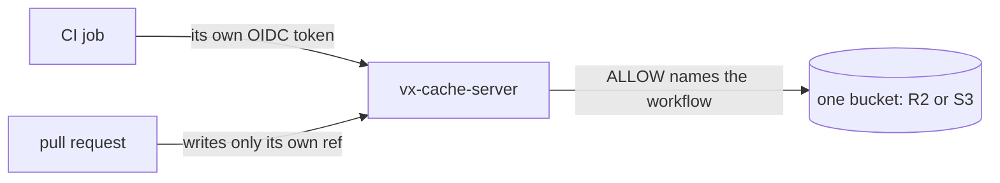

Host the remote cache yourself, in one bucket with no database. A hit
puts back exactly what the task wrote, a lockfile change re-runs what
it reaches, and a config mistake is refused with its fix.

This release is breaking. Read the [breaking changes](#breaking-changes) first.

**In this release**

- [Host the remote cache yourself](#host-the-remote-cache-yourself)
- [A hit puts back exactly what ran](#a-hit-puts-back-exactly-what-ran)
- [A lockfile change re-runs what it reaches](#a-lockfile-change-re-runs-what-it-reaches)
- [A config mistake is refused with its fix](#a-config-mistake-is-refused-with-its-fix)
- [Other noteworthy changes](#other-noteworthy-changes)
- [How to update](#how-to-update)
- [Breaking changes](#breaking-changes)

## Host the remote cache yourself



Your CI runners and laptops share one cache, kept in a bucket you own.
`@vzn/vx-cache-server` runs on Cloudflare Workers, Bun or Docker. Each
CI job signs in with its own token, so no secret is stored.

```ts
// .vx/workspace.ts
import { defineWorkspace } from '@vzn/vx/config'
import { vxCache } from '@vzn/vx-cache'

export default defineWorkspace({
  plugins: [
    vxCache({
      url: 'https://cache.example.com',
      issuer: 'https://token.actions.githubusercontent.com',
      repository: 'acme/app',
    }),
  ],
})
```

A CI job on `main` fills it, and a laptop with an empty local cache
reads the hit back:

```sh frame="terminal"
# CI job on main
$ vx run build
└─ //#build ── (12ms) success
            remote 1↑ 270 B

# laptop, empty local cache
$ vx run build
┌─ //#build > $ mkdir -p dist && cp src/*.ts dist/
└─ //#build ── (30ms) restored-remote
            remote 1↓ 270 B
```

A 5xx or 429 from GitHub's token endpoint is tried again.
`@vzn/vx-history-server` keeps task timings the same way. See
[Remote cache](../../docs/remote-cache/).

## A hit puts back exactly what ran

```sh frame="terminal"
$ rm -rf dist
$ vx run build
┌─ //#build > $ mkdir -p dist/keys && cp src/*.ts dist/keys/ && chmod 700 dist/keys
└─ //#build ── (11ms) restored-local
$ ls -ld dist/keys
drwx------ 2 root root 4096 Oct 29 08:40 dist/keys
```

A hit gives each output directory the mode the task left, so
`dist/keys` stays private. A restore never writes into `.git` through a
link.

## A lockfile change re-runs what it reaches

```sh frame="terminal"
$ vx run build --affected=HEAD~1 --dry
would run:
  ∅  app#build  no-cache (would exec)     6cea8c21
                affected: packages/lib/index.js changed (an input), via lib#build
  ∅  lib#build  no-cache (would exec)     ec139120
                affected: packages/lib/index.js changed (an input)

2 task(s) planned, 2 no-cache.
```

`app` never names `lib`, but the root `package.json` installs it for
every package, so an edit to `lib` selects `app` too.

A pnpm catalog bump re-runs only the projects that use it. See
[Lockfiles](../../docs/lockfiles/).

## A config mistake is refused with its fix

```sh frame="terminal"
$ vx lock
✗ vx lock  lock not written

  vx.config.ts:6:17
  tasks.build.inputs.files: "src/**.ts" glues ** to other text in one path segment, which vx's glob engine reads as one *, a single directory level. Write "src/**/*.ts" for every depth, or "src/*.ts" for one level.
```

`src/**.ts` reads one level, so a deeper edit would replay a stale hit.
`baseBranch: 'origin/main'` and a `5M` duration are refused too.

## Other noteworthy changes

- `vx last --live` shows a run in progress from another shell;
  `vx last --sql` queries run history.
- `--affected` works on CI's one-commit checkout.
- A merge queue's run reads and writes the branch it merges into.
- `exec.platforms` names the machines a task runs on.

## How to update

```sh frame="terminal"
vx upgrade
```

## Breaking changes

- Every cached task misses once (`vx-cache-v50`, schema `v49`).
- CLI and config: `--dry-run` → `--dry`, `--dry=text` → `--dry=pretty`;
  `baseBranch: 'origin/main'` and a `5M` duration are refused.
- Plugins: `@vzn/vx-schedule-history` → `@vzn/vx-history`;
  `turboCache()` and `nxCache()` take `url` and `token`; `reapi()` reads
  no `VX_REAPI_*` variable; `github({ checks })` and `otel({ post })` →
  removed.
- Plugin API: `RunResult.signal` may be a number;
  `FingerprintClaim.extraFiles` takes a `ctx`.

See also [Upgrading](../../guides/upgrading/).
