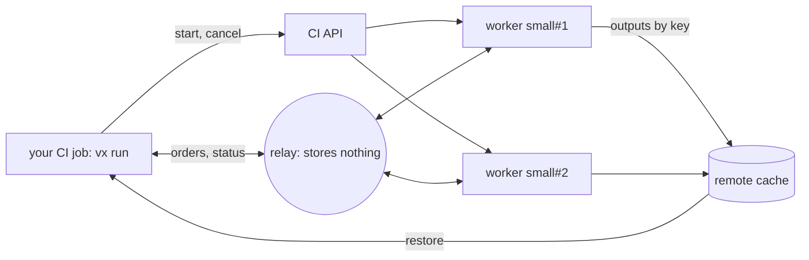
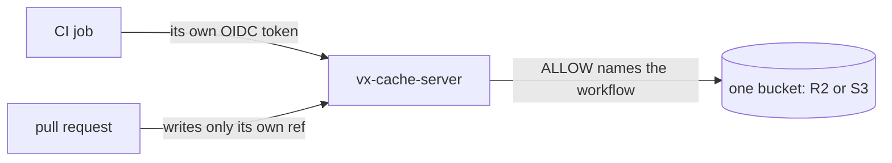

Distributed task execution (DTE) spreads one `vx run` over workers your
own CI starts. There is no vendor cloud: the relay between them is a server you host.

This release is breaking. Read the [breaking changes](#breaking-changes) first.

## Spread one run over your own CI workers



Your CI job's `vx run` starts workers through your CI's API and hands
them the tasks the cache cannot answer.

Workers save outputs to your remote cache, and the run restores them.
Each side signs in with its CI job's OIDC token, so no secret is stored.

```ts
// .vx/workspace.ts
import { defineWorkspace } from '@vzn/vx/config'
import { dte, github } from '@vzn/vx-dte'

export default defineWorkspace({
  plugins: [
    dte({
      relay: 'https://relay.example.com',
      workers: { small: { max: 8, cpu: 4, memory: '16GB' } },
      adapter: github(),
    }),
  ],
})
```

`workers` names the sizes the run may start. `gitlab()` starts workers
as GitLab pipelines.

```sh frame="terminal"
$ vx dte init
vx dte init: wrote .github/workflows/ci.yml
vx dte init: wrote .github/workflows/vx-worker.yml

Next:
  1. Let these workflows use the relay at https://relay.example.com: set its ALLOW.
     Its ALLOW (a plain var, no secret): https://token.actions.githubusercontent.com:acme/app:ci.yml https://token.actions.githubusercontent.com:acme/app:vx-worker.yml
  2. A remote cache the run and the workers share: workers hand back outputs only through it. https://vznjs.github.io/vx/docs/remote-cache/
  3. Commit .github/workflows/ci.yml, .github/workflows/vx-worker.yml, .vx/workspace.ts and the lock (vx lock), and push.
  How a run spreads over workers: https://vznjs.github.io/vx/docs/distributed-task-execution/
```

`vx dte init` writes both workflows and prints what is left.

### Watch a run on your machine

`local()` starts each worker in its own git worktree, with no CI:

```ts
dte({ workers: { small: { max: 3, cpu: 1, memory: '2GB' } }, adapter: local() })
```

```sh frame="terminal"
$ VX_DTE_RUN=$(uuidgen) vx run test --all --force
 ⏺︎   3.01s success miss     ui#test · small#2
 ⏺︎   3.41s success miss     web#test · small#1
 ⏺︎   2.21s success miss     billing#test · small#1
 ⏺︎   2.61s success miss     search#test · small#2
 ⏺︎   1.41s success miss     api#test · small#2
 ⏺︎   1.81s success miss     auth#test · small#1

  workers   small#1  stopped  3 done · warm-up 0.1s
                     declared 1c/2G · actual 4c/14G
                     online 7.5s · busy 7.5s · idle 0.0s
                     cpu peak 2.0 · used avg 1.0 cores · machine avg 2.0 · booked avg 1.0 · cpu utilization 98%
                     sent 3 messages · 4 KB, received 3 messages · 617 B
            small#2  left     3 done · warm-up 0.2s
                     declared 1c/2G · actual 4c/14G
                     online 7.1s · busy 7.1s · idle 0.0s
                     cpu peak 2.0 · used avg 1.0 cores · machine avg 2.0 · booked avg 1.0 · cpu utilization 99%
                     sent 3 messages · 4 KB, received 3 messages · 621 B
            probe    at 0.0s: 6 tasks left to run, 0 known misses
            asked    2 at 0.0s for 6 tasks (6 measured), plan 27.4s
            ideal    5.0s: each task as long as it took, placed perfectly
            total    cpu utilization 98%

  time      7.65s · max 3.41s · avg 2.41s · min 1.41s
```

The footer shows each worker's time and CPU use.

### A relay restart does not lose the run

The relay stores nothing, so a restart loses no state. The run and its
workers join again within 4 s while tasks keep running.

See [Distributed task execution](../../docs/distributed-task-execution/).

## Task timings from a server you host

```ts
// .vx/workspace.ts
import { defineWorkspace } from '@vzn/vx/config'
import { vxHistory } from '@vzn/vx-history'

export default defineWorkspace({
  plugins: [
    vxHistory({
      url: 'https://history.example.com',
      issuer: 'https://token.actions.githubusercontent.com',
      repository: 'acme/app',
    }),
  ],
})
```

`@vzn/vx-history-server` keeps each task's duration, cores and peak
memory. A fresh CI runner reads them, starts the longest work first,
and DTE plans its workers by them.

```sh frame="terminal"
$ vx last --live
run 01a18750-df8a-74a5-9878-0f0df6bdf9e5 — running 2.52s
  $ vx run test --all --force
  3 running · 3 ended · 0 waiting

  running  search#test   2.51s
  running  ui#test       1.09s
  running  web#test      689ms
  success  api#test      1.41s
  success  auth#test     1.81s
  success  billing#test  2.21s

$ vx last --sql "SELECT project, COUNT(*) AS runs, MAX(duration_ms) AS slowest_ms FROM runs GROUP BY project ORDER BY slowest_ms DESC LIMIT 3"
project  runs  slowest_ms
web      2     3411
ui       2     3009
search   2     2609
```

`vx last --live` shows a running run; `--sql` queries the history.

## Host the remote cache yourself



`@vzn/vx-cache-server` keeps the cache in one bucket you own.

```ts
// .vx/workspace.ts
import { defineWorkspace } from '@vzn/vx/config'
import { vxCache } from '@vzn/vx-cache'

export default defineWorkspace({
  plugins: [
    vxCache({
      url: 'https://cache.example.com',
      issuer: 'https://token.actions.githubusercontent.com',
      repository: 'acme/app',
    }),
  ],
})
```

CI fills it, and a laptop reads the hit back:

```sh frame="terminal"
# CI job on main
$ vx run build
└─ //#build ── (12ms) success
            remote 1↑ 270 B

# laptop, empty local cache
$ vx run build
┌─ //#build > $ mkdir -p dist && cp src/*.ts dist/
└─ //#build ── (30ms) restored-remote
            remote 1↓ 270 B
```

See [Remote cache](../../docs/remote-cache/).

## A hit puts back exactly what ran

A restore that loosens a directory's mode would expose what the task
kept private:

```sh frame="terminal"
$ rm -rf dist
$ vx run build
┌─ //#build > $ mkdir -p dist/keys && cp src/*.ts dist/keys/ && chmod 700 dist/keys
└─ //#build ── (11ms) restored-local
$ ls -ld dist/keys
drwx------ 2 root root 4096 Oct 29 08:40 dist/keys
```

Now a hit gives each output directory the mode the task left.

## A lockfile change re-runs what it reaches

```sh frame="terminal"
$ vx run build --affected=HEAD~1 --dry
would run:
  ∅  app#build  no-cache (would exec)     6cea8c21
                affected: packages/lib/index.js changed (an input), via lib#build
  ∅  lib#build  no-cache (would exec)     ec139120
                affected: packages/lib/index.js changed (an input)

2 task(s) planned, 2 no-cache.
```

`app` never names `lib`, but the root `package.json` installs it, so
`app` re-runs too.

See [Lockfiles](../../docs/lockfiles/).

## A config mistake is refused with its fix

A glob that matches less than you meant replays a stale hit, so vx
refuses it:

```sh frame="terminal"
$ vx lock
✗ vx lock  lock not written

  vx.config.ts:6:17
  tasks.build.inputs.files: "src/**.ts" glues ** to other text in one path segment, which vx's glob engine reads as one *, a single directory level. Write "src/**/*.ts" for every depth, or "src/*.ts" for one level.
```

## How to update

```sh frame="terminal"
vx upgrade
```

## Breaking changes

Every cached task misses once (`vx-cache-v51`, schema `v49`).
`baseBranch: 'origin/main'` and a `5M` duration are refused.

| Before | Now |
| --- | --- |
| `--dry-run`, `--dry=text` | `--dry`, `--dry=pretty` |
| `@vzn/vx-schedule-history`, `scheduleHistoryPlugin()` | `@vzn/vx-history`, `vxHistory()` |
| `defaultBranch` | `baseBranch` |
| history through the remote cache | a history server, `vxHistory({ url })` |
| `turboCache()`, `nxCache()` options | `url` and `token` |
| `VX_REAPI_*` variables | `reapi()` options |
| `github({ checks })`, `otel({ post })` | removed |
| `RunResult.signal` a string | a string or a number |
| `FingerprintClaim.extraFiles` | takes a `ctx` |

See also [Upgrading](../../guides/upgrading/).
