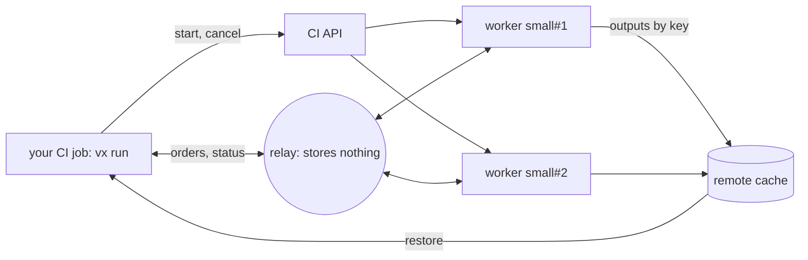
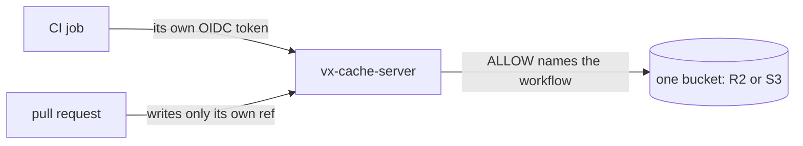

Distributed task execution (DTE) spreads one `vx run` over workers your
own CI starts. Below, six tests ran on two workers, and the footer
shows how close the run came to ideal.

There is no vendor cloud. The relay between the run and its workers is
a server you host, and it stores nothing.

This release is breaking. Read the [breaking changes](#breaking-changes) first.

**In this release**

- [Spread one run over your own CI workers](#spread-one-run-over-your-own-ci-workers)
- [Task timings from a server you host](#task-timings-from-a-server-you-host)
- [Host the remote cache yourself](#host-the-remote-cache-yourself)
- [A hit puts back exactly what ran](#a-hit-puts-back-exactly-what-ran)
- [A lockfile change re-runs what it reaches](#a-lockfile-change-re-runs-what-it-reaches)
- [A config mistake is refused with its fix](#a-config-mistake-is-refused-with-its-fix)
- [Other noteworthy changes](#other-noteworthy-changes)
- [How to update](#how-to-update)
- [Breaking changes](#breaking-changes)

## Spread one run over your own CI workers



Your CI job's `vx run` is the orchestrator. It finds the tasks the cache
cannot answer, starts workers through your CI's API, and hands them out.

Workers save outputs to your remote cache, and the run restores them as
if the tasks ran there. Each side signs in with its CI job's OIDC
token, so no secret is stored.

```ts
// .vx/workspace.ts
import { defineWorkspace } from '@vzn/vx/config'
import { dte, github } from '@vzn/vx-dte'

export default defineWorkspace({
  plugins: [
    dte({
      relay: 'https://relay.example.com',
      workers: { small: { max: 8, cpu: 4, memory: '16GB' } },
      adapter: github(),
    }),
  ],
})
```

`workers` names the sizes the run may start: here up to 8 workers with
4 cores and 16 GB each. `gitlab()` starts workers as GitLab pipelines.

```sh frame="terminal"
$ vx dte init
vx dte init: wrote .github/workflows/ci.yml
vx dte init: wrote .github/workflows/vx-worker.yml

Next:
  1. Let these workflows use the relay at https://relay.example.com: set its ALLOW.
     Its ALLOW (a plain var, no secret): https://token.actions.githubusercontent.com:acme/app:ci.yml https://token.actions.githubusercontent.com:acme/app:vx-worker.yml
  2. A remote cache the run and the workers share: workers hand back outputs only through it. https://vznjs.github.io/vx/docs/remote-cache/
  3. Commit .github/workflows/ci.yml, .github/workflows/vx-worker.yml, .vx/workspace.ts and the lock (vx lock), and push.
  How a run spreads over workers: https://vznjs.github.io/vx/docs/distributed-task-execution/
```

`vx dte init` writes the run's workflow and the workers' from `dte()`.
Then it prints what is left to do.

### Watch a run on your machine

`local()` starts each worker as a process in its own git worktree, so
you can watch a run with no CI:

```ts
dte({ workers: { small: { max: 3, cpu: 1, memory: '2GB' } }, adapter: local() })
```

```sh frame="terminal"
$ VX_DTE_RUN=$(uuidgen) vx run test --all --force
 ⏺︎   3.01s success miss     ui#test · small#2
 ⏺︎   3.41s success miss     web#test · small#1
 ⏺︎   2.21s success miss     billing#test · small#1
 ⏺︎   2.61s success miss     search#test · small#2
 ⏺︎   1.41s success miss     api#test · small#2
 ⏺︎   1.81s success miss     auth#test · small#1

  workers   small#1  stopped  3 done · warm-up 0.1s
                     declared 1c/2G · actual 4c/14G
                     online 7.5s · busy 7.5s · idle 0.0s
                     cpu peak 2.0 · used avg 1.0 cores · machine avg 2.0 · booked avg 1.0 · cpu utilization 98%
                     sent 3 messages · 4 KB, received 3 messages · 617 B
            small#2  left     3 done · warm-up 0.2s
                     declared 1c/2G · actual 4c/14G
                     online 7.1s · busy 7.1s · idle 0.0s
                     cpu peak 2.0 · used avg 1.0 cores · machine avg 2.0 · booked avg 1.0 · cpu utilization 99%
                     sent 3 messages · 4 KB, received 3 messages · 621 B
            probe    at 0.0s: 6 tasks left to run, 0 known misses
            asked    2 at 0.0s for 6 tasks (6 measured), plan 27.4s
            ideal    5.0s: each task as long as it took, placed perfectly
            total    cpu utilization 98%

  time      7.65s · max 3.41s · avg 2.41s · min 1.41s
```

Each row names the worker that ran it. The `workers` rows show live
while the run goes, and the footer adds each worker's time and CPU use.

`asked` is the end the run planned when it asked for workers, counting
20 s to start each one when none has started before. `ideal` is the
end had every task been placed perfectly.

### A relay restart does not lose the run

- The relay stores nothing. When it restarts, the run and each worker
  join again within 4 s, and tasks keep running meanwhile.
- A task naming `exec.platforms` runs only on a worker of that
  platform. A Mac worker starts only when the run has a Mac task.
- A worker the plan no longer needs is cancelled, so it does not hold
  a runner. At its end the run cancels every worker run it started.

`packages/vx-dte/scripts/sim.ts` replays a run fixture on the planner's
own code, so you can try worker counts and strategies from the shell:

```sh frame="terminal"
$ bun packages/vx-dte/scripts/sim.ts packages/vx-dte/tests/fixtures/main-run-a09b987.json --max 4
packages/vx-dte/tests/fixtures/main-run-a09b987.json: 65 tasks ran, strategy critical-path / best-fit / measured / plan
end       213.6s  (best any worker count: 213.6s)
cpu       88% of joined workers' cores
churn     0   over-sent 0
  small#1    joined 20.0s, left 211.1s     20 done · busy 191.1s · idle 0.0s
  small#2    joined 20.0s, left 213.6s     17 done · busy 193.6s · idle 0.0s
  small#3    joined 20.0s, left 207.7s     13 done · busy 187.7s · idle 0.1s
  small#4    joined 20.0s, left 212.5s     15 done · busy 192.4s · idle 0.1s
```

See [Distributed task execution](../../docs/distributed-task-execution/).

## Task timings from a server you host

```ts
// .vx/workspace.ts
import { defineWorkspace } from '@vzn/vx/config'
import { vxHistory } from '@vzn/vx-history'

export default defineWorkspace({
  plugins: [
    vxHistory({
      url: 'https://history.example.com',
      issuer: 'https://token.actions.githubusercontent.com',
      repository: 'acme/app',
    }),
  ],
})
```

`@vzn/vx-history-server` keeps one row per task: its duration, cores
and peak memory. It runs on Bun with SQLite, Cloudflare Workers with
D1, or Docker.

A fresh CI runner reads the timings of its branch, then its base, then
the default branch. The longest work starts first, and DTE plans its
workers by them.

A timing belongs to the task's command and `env.define`. Change the
command and its old timings go; edit its inputs and they stay.

```sh frame="terminal"
$ vx last --live
run 01a18750-df8a-74a5-9878-0f0df6bdf9e5 — running 2.52s
  $ vx run test --all --force
  3 running · 3 ended · 0 waiting

  running  search#test   2.51s
  running  ui#test       1.09s
  running  web#test      689ms
  success  api#test      1.41s
  success  auth#test     1.81s
  success  billing#test  2.21s

$ vx last --sql "SELECT project, COUNT(*) AS runs, MAX(duration_ms) AS slowest_ms FROM runs GROUP BY project ORDER BY slowest_ms DESC LIMIT 3"
project  runs  slowest_ms
web      2     3411
ui       2     3009
search   2     2609
```

`vx last --live` shows a run in progress from another shell.
`vx last --sql` runs one read-only `SELECT` over the run history.

## Host the remote cache yourself



`@vzn/vx-cache-server` keeps the cache in one bucket you own, with no
database. It runs on Cloudflare Workers, Bun or Docker.

```ts
// .vx/workspace.ts
import { defineWorkspace } from '@vzn/vx/config'
import { vxCache } from '@vzn/vx-cache'

export default defineWorkspace({
  plugins: [
    vxCache({
      url: 'https://cache.example.com',
      issuer: 'https://token.actions.githubusercontent.com',
      repository: 'acme/app',
    }),
  ],
})
```

A CI job on `main` fills it, and a laptop with an empty local cache
reads the hit back:

```sh frame="terminal"
# CI job on main
$ vx run build
└─ //#build ── (12ms) success
            remote 1↑ 270 B

# laptop, empty local cache
$ vx run build
┌─ //#build > $ mkdir -p dist && cp src/*.ts dist/
└─ //#build ── (30ms) restored-remote
            remote 1↓ 270 B
```

See [Remote cache](../../docs/remote-cache/).

## A hit puts back exactly what ran

```sh frame="terminal"
$ rm -rf dist
$ vx run build
┌─ //#build > $ mkdir -p dist/keys && cp src/*.ts dist/keys/ && chmod 700 dist/keys
└─ //#build ── (11ms) restored-local
$ ls -ld dist/keys
drwx------ 2 root root 4096 Oct 29 08:40 dist/keys
```

A hit gives each output directory the mode the task left, so
`dist/keys` stays private. A restore never writes into `.git` through a
link.

## A lockfile change re-runs what it reaches

```sh frame="terminal"
$ vx run build --affected=HEAD~1 --dry
would run:
  ∅  app#build  no-cache (would exec)     6cea8c21
                affected: packages/lib/index.js changed (an input), via lib#build
  ∅  lib#build  no-cache (would exec)     ec139120
                affected: packages/lib/index.js changed (an input)

2 task(s) planned, 2 no-cache.
```

`app` never names `lib`, but the root `package.json` installs it for
every package, so an edit to `lib` selects `app` too.

See [Lockfiles](../../docs/lockfiles/).

## A config mistake is refused with its fix

```sh frame="terminal"
$ vx lock
✗ vx lock  lock not written

  vx.config.ts:6:17
  tasks.build.inputs.files: "src/**.ts" glues ** to other text in one path segment, which vx's glob engine reads as one *, a single directory level. Write "src/**/*.ts" for every depth, or "src/*.ts" for one level.
```

`src/**.ts` reads one level, so a deeper edit would replay a stale hit.

## Other noteworthy changes

- `--affected` works on CI's one-commit checkout.
- A merge queue's run reads and writes the branch it merges into.
- A 5xx or 429 from GitHub's token endpoint is tried again.

## How to update

```sh frame="terminal"
vx upgrade
```

## Breaking changes

- Every cached task misses once (`vx-cache-v51`, schema `v49`).
- CLI and config: `--dry-run` → `--dry`, `--dry=text` → `--dry=pretty`;
  `baseBranch: 'origin/main'` and a `5M` duration are refused.
- History: `@vzn/vx-schedule-history` → `@vzn/vx-history`,
  `scheduleHistoryPlugin()` → `vxHistory()`, `defaultBranch` →
  `baseBranch`; timings shared through the remote cache need a history
  server (`vxHistory({ url })`).
- Plugins: `turboCache()` and `nxCache()` take `url` and `token`;
  `reapi()` reads no `VX_REAPI_*` variable; `github({ checks })` and
  `otel({ post })` → removed.
- Plugin API: `RunResult.signal` may be a number;
  `FingerprintClaim.extraFiles` takes a `ctx`.

See also [Upgrading](../../guides/upgrading/).
