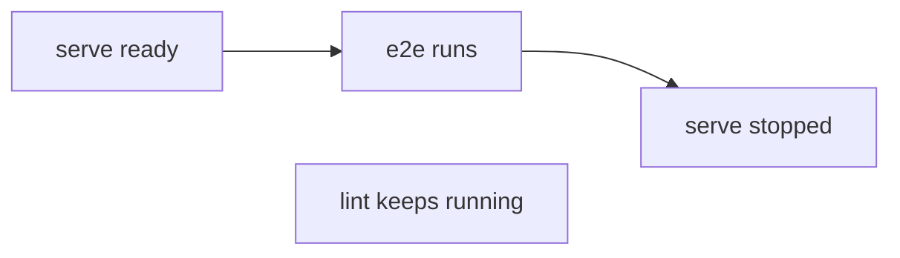

Distributed task execution can send one task to another kind of
machine. Workers and servers run only while a task needs them. The
task list is one line per task.

A failed cache restore fails its task. A config mistake is shown at
its line.

This release is breaking. Read the [breaking changes](#breaking-changes) first.

**In this release**

- [Send one task to another kind of machine](#send-one-task-to-another-kind-of-machine)
- [Workers and servers run only while needed](#workers-and-servers-run-only-while-needed)
- [One line per task](#one-line-per-task)
- [A failed restore is a failed task](#a-failed-restore-is-a-failed-task)
- [Config refusals point at their line](#config-refusals-point-at-their-line)

## Send one task to another kind of machine

With Alpine workers, there was no way to send one Playwright task to
Ubuntu. `exec.platforms` says where a task *can* run, and every
Linux worker looked the same.

`dte()` now names **worker types**, each with its **machines**. A task
picks a type with `exec.worker`.

Any other task goes to the first type, in declared order, with a
machine on one of its platforms. A costly type listed last gets only
the tasks no other type can take.

```ts
// .vx/workspace.ts
dte({
  workers: {
    alpine: { machines: { small: { max: 8, cpu: 4, memory: '16GB' } } },
    ubuntu: { machines: { small: { max: 2, cpu: 4, memory: '16GB', runsOn: 'ubuntu-latest' } } },
  },
  adapter: github(),
})
```

```ts
// apps/web/vx.config.ts
import { defineProject } from '@vzn/vx/config'

export default defineProject({
  tasks: {
    e2e: { exec: { command: 'bunx playwright test', worker: 'ubuntu' } },
  },
})
```

A name no type has, or a type with no machine on the task's platforms,
refuses the run before any worker starts. On your own machine
`exec.worker` is ignored, and it never changes a cache key.

See [Distributed task execution](../../docs/distributed-task-execution/).

## Workers and servers run only while needed

A run could start four Macs for work two would finish long before the
Linux work ended, and a short arm task waited behind x64 work while the
arm worker sat idle.

Now every ready task goes to the run's own queue, which knows which
platform's worker is free. A platform starts the fewest workers that still
finish its work two warm-ups before the run ends.

A machine counts as crowded only when its cores are all busy, so a
task is booked by the CPU it used. The footer's `best` line uses the
same rule, so it advises the workers the run would start.

The footer also says where each worker's CPU went, from its first task to
its last: the machine's, its tasks' and the worker process's own.

```ansi
$ VX_DTE_RUN=$(uuidgen) vx run test --all
  workers   alpine.small#1  stopped  4 done · warm-up 0.1s
                            declared 4c/14G · actual 4c/14G
                            online 4.6s · busy 4.6s · idle 0.0s
                            cpu peak 2.0 · used avg 1.3 cores · machine avg 1.4 · booked avg 1.3
                            cpu utilization machine 35% · tasks 33% · worker 1%
                            memory peak 11.5 MB · avg 7.6 MB
                            sent 3 messages · 5 KB, received 4 messages · 1 KB
            probe           at 0.0s: 4 tasks left to run, 4 known misses
            asked           1 at 0.0s for 4 tasks (4 measured), plan 24.5s
            ideal           4.7s: each task as long as it took, placed perfectly
            best            1 × alpine.small (4c/14G linux-x64): 4.7s, the fewest of its sizes
            any             1 × (2c/7G linux-x64): 4.7s, of any cores, the least core time
            total           cpu utilization machine 35% · tasks 33% · worker 1%
```

A dev server a test depends on ran until the whole run ended, holding
its machine's cores while unrelated tasks ran.

Now a server gets `SIGTERM` as soon as every task that uses it has
finished, while the rest of the run goes on. On a worker it stops the
same way, and starts again if a later task there needs it.



A worker also learns what a server costs: its idle CPU, booked once per
worker, and the CPU each dependant adds while it runs. Workers are no
longer overfilled by servers no task was charged for.

See [Distributed task execution](../../docs/distributed-task-execution/)
and [Dev servers as graph nodes](../../blog/dev-servers-in-the-graph/).

## One line per task

The task list had two rules, a repeated header, a glyph column and blank
cells, so a row took a moment to read.

Now each section is one underlined line that carries the column header.
A row starts with its status, then cache, the change from its usual time,
and time.

An empty cell reads `—`, and a yellow ◆ before a name marks the
critical path. `vx last` draws the same grid. Under `--all`, a cache hit
prints no row.

```ansi
$ vx run test --all
  Tasks     status  cache     ±usual    time   cpu    mem outputs  blocks worker         task                           
            success miss        +6ms   311ms    2%  3.6MB     34B       1 local          packages/app#build
            success miss        +3ms   208ms    2%      —      0B       0 local          packages/app#test


  Summary                                                                                                       vx 0.0.653
  projects  ▰▰▰▰▰▰▰▰▰▰▰▰▰▰▰▰▰▰▰▰▰▰▰▰▰▰▰▰▰▰▰▰▰▱▱▱▱▱▱▱▱▱▱▱▱▱▱▱▱▱
            2 affected · 3 total
  tasks     ▰▰▰▰▰▰▰▰▰▰▰▰▰▰▰▰▰▰▰▰▰▰▰▰▰▰▰▰▰▰▰▰▰▰▰▰▰▰▰▰▰▰▰▰▰▰▰▰▰▰
            4 success · 4 total
  cache     ▰▰▰▰▰▰▰▰▰▰▰▰▰▰▰▰▰▰▰▰▰▰▰▰▰▰▰▰▰▰▰▰▰▰▰▰▰▰▰▰▰▰▰▰▰▰▰▰▰▰
            local 2✓ 2↑

  info      4 workers · local cache · run 01a1b5f9-2a6d-75d7-b693-e812b8a4d408
  time      573ms · max 311ms · avg 260ms · min 208ms
```

See [Running tasks](../../docs/running-tasks/).

## A failed restore is a failed task

A cache hit whose restore failed read as a miss that ran: a `$ command`
line for a command that never ran, `exit 1`, and a miss in history.

Now such a task is failed and nothing else: no miss, no hit, no command.
Its row reads `failed`; its frame and `vx last` say
`cache restore failed`, and the cache bar shows it in red.

```ansi
$ vx run build --filter packages/lib
  Tasks     status  cache     ±usual    time   cpu    mem outputs  blocks worker         task                           
            failed  —              —     0ms     —      —       —       0 local          packages/lib#build

┌─ packages/lib#build > failed (cache restore failed)
├─ OUTPUT ────────────────────────────────────────────────────

[vx] packages/lib#build: /home/user/acme/packages/lib/dist is a symbolic link to /home/user/out, outside /home/user/acme/packages/lib — vx never cleans, saves or restores declared outputs through a link that leaves the project. Remove the link and re-run, or stop declaring outputs under it.

└─ packages/lib#build ── (0ms) failed (cache restore failed)


  Summary                                                                                                       vx 0.0.653
  projects  ▰▰▰▰▰▰▰▰▰▰▰▰▰▰▰▰▰▱▱▱▱▱▱▱▱▱▱▱▱▱▱▱▱▱▱▱▱▱▱▱▱▱▱▱▱▱▱▱▱▱
            1 affected · 3 total
  tasks     ▰▰▰▰▰▰▰▰▰▰▰▰▰▰▰▰▰▰▰▰▰▰▰▰▰▰▰▰▰▰▰▰▰▰▰▰▰▰▰▰▰▰▰▰▰▰▰▰▰▰
            1 failed · 1 total
  cache     ▰▰▰▰▰▰▰▰▰▰▰▰▰▰▰▰▰▰▰▰▰▰▰▰▰▰▰▰▰▰▰▰▰▰▰▰▰▰▰▰▰▰▰▰▰▰▰▰▰▰

  info      4 workers · local cache · run 01a1b5f9-0cd8-76d3-98ff-9c88d9e65061
  time      12ms
```

## Config refusals point at their line

A refusal named what was wrong but not where, so you searched your
configs for it.

Now `vx lock` frames a `dependsOn` naming no task at its config line,
with the near name as the `fix`.

`cache.policy` and `run.rules.dependencies` refusals are framed in
`.vx/workspace.ts`. A size with no unit, such as `'32'`, names `'32KiB'`
or `'32B'`.

```ansi
$ vx lock
✗ vx lock  lock not written

  packages/app/vx.config.ts:7:7
  tasks.build.dependsOn names packages/lib#biuld, but packages/lib declares no task biuld

    5 |     build: {
    6 |       exec: { command: 'sleep 0.3 && mkdir -p dist && cp src/*.js dist/' },
  > 7 |       dependsOn: ['packages/lib#biuld'],
      |       ^

  fix  use packages/lib#build
```

See [Tasks](../../docs/tasks/).

## Other noteworthy changes

- Ctrl-C on a run keeps what the stopped tasks printed, framed above the summary.
- `vx watch` keeps watching dependencies after a failed cycle, and reruns when an edit is undone.
- `vx lock` writes both lock files or neither.
- `vx run t -- --fix` reaches a command that ends in a redirect, such as `(cd web && vite) 2>&1`.
- A sandboxed task reads only the declared outputs of its dependencies, not the directory above them.
- `vx last --log` shows the run's own log.
- `vx cache clean` says it clears run history too; `vx last --stats` prints the grid's units.
- After a failed `vx lock`, `vx run` names the config the lock holds no project for.
- A remote cache whose token is refused still serves its hits, and so do `turboCache()` and `nxCache()`.
- The cache, history and DTE servers ship as images: `ghcr.io/vznjs/vx-cache-server`, `ghcr.io/vznjs/vx-history-server` and `ghcr.io/vznjs/vx-dte-server`.

## How to update

```sh frame="terminal"
vx upgrade
```

## Breaking changes

Run `vx lock` after changing your configs. The local cache index starts
over once, so the first run misses and run history begins again.

- `dte({ workers: { <size>: {...} } })` → `dte({ workers: { <type>: { machines: { <name>: {...} } } } })`.
- `github({ runsOn })` → removed: each machine names its runner with `runsOn`.
- Machine names in output and `gitlab({ tags })` → `<type>.<machine>` (`linux.small#1`).
- A size with no unit (`'32'`, `VX_CACHE_STORE_EMBEDDINGS=32`) → refused; write `'32KiB'` or `'32B'`.
- A negation-only `inputs.tasks` list, and a `pkg#task` naming only a transitive dependency → refused.
- `vxCache()` sends several scopes in one header: deploy the new `vx-cache-server` first, then upgrade. `VxCacheLayer.start()` → removed.
- `Blobs.size(key)` → `Blobs.size(key, bucket)` in a store of your own.
- A remote cache layer's `get` may return `undefined` (no answer): treat it as a miss. Its `put` meta may carry `replace`.
- `Cache.formatChange` → removed; `Cache.recordRuns` takes the run's head.

See also [Upgrading](../../guides/upgrading/).
