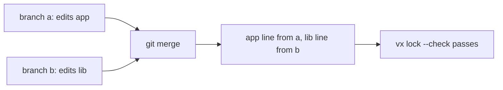

The locks are now text, a line per project, so two pull requests that
each ran `vx lock` merge them by project. A merge touches only what each
branch changed.

The waits and limits a user can feel are settings. vx keeps its memory
flat under huge outputs, big inputs and slow readers.

This release has breaking changes: read
[Breaking changes](#breaking-changes) first.

**In this release**

- [Locks merge by project](#locks-merge-by-project)
- [Waits and limits are settings](#waits-and-limits-are-settings)
- [vx stays small under load](#vx-stays-small-under-load)
- [Migrated configs hold only their own inputs](#migrated-configs-hold-only-their-own-inputs)

## Locks merge by project

Every install rewrote one hash at the top of the dependencies lock. Two
pull requests that touched the lockfile conflicted there, even when
they changed different projects.

Both locks are now sorted text keyed by project name:

- **`.vx/projects.lock`** holds each project's final config, a
  line per project, and each distinct task once on its own line.
- **`.vx/dependencies.lock`** holds each project's edges and digests,
  a line per project. A run checks the digests against the lockfile.



Here one branch changed `app`'s build and the other `lib`'s:

```ansi
$ git merge b
Auto-merging .vx/projects.lock
Merge made by the 'ort' strategy.
$ vx lock --check
✓ vx lock --check  up to date (2 projects)
```

Only a project both sides changed conflicts; then a run refuses the
lock until `vx lock` rewrites it.

The locks stay LF in a clone that checks text out as CRLF.

See [vx lock](../../cli/lock/).

## Waits and limits are settings

vx had fixed values a user could feel but not change. A server needing
ten seconds to shut down was killed after two.

Each is now a setting in `.vx/workspace.ts`, or its `VX_` variable,
which wins. Defaults keep today's values:

- **Stopping:** `run.killGrace` (2 s from SIGTERM to SIGKILL),
  `run.pluginTimeout` (3 s for a plugin's flush).
- **Logs:** `run.logs.captureHead` / `captureTail` and
  `run.logs.failedHead` / `failedTail`; `run.secrets.minLength`.
- **Watch:** `watch.debounce`, `watch.pollInterval`.
- **Cache and history:** `cache.artifactCeiling` (now 1 GiB),
  `history.retention` (30 days).
- **Plugins:** `vxCache({ retries })` and
  `vxHistory({ timeoutMs, retries })`.

```ts
// .vx/workspace.ts
import { defineWorkspace } from '@vzn/vx/config'

export default defineWorkspace({
  run: { killGrace: '10s' },
  cache: { artifactCeiling: '4GiB' },
  history: { retention: '60d' },
})
```

`vx info` lists every setting you changed and where from:

```ansi
$ vx info
  settings          run.killGrace 10s (.vx/workspace), cache.artifactCeiling 4GiB (.vx/workspace), history.retention 60d (.vx/workspace)
```

See [Settings](../../schema/workspace/#settings).

## vx stays small under load

vx's memory grew with the size of what it moved. A big asset repo or a
chatty task could run a CI runner out of memory.

- **A slow reader** (`vx run app#test | slow-tool`) now holds the task
  back on its pipe, as it would without vx, not in vx's memory.
- **Big inputs** stream through the hasher a chunk at a time, 32 files
  at once. `@vzn/vx-reapi` holds them by path until upload.
- **A failed task's outputs** stream to the remote from a spool under
  `.vx/tmp/`, not one tar in memory.
- **A saved tree** is counted without walking its links, so a copied
  `node_modules` with link cycles no longer ends the run.

The test suite now holds vx under memory ceilings: huge output, 2,000
tasks, a 1,000-project graph, big remote outputs and long watch
sessions.

## Migrated configs hold only their own inputs

`bunx @vzn/vx-migrate` put turbo.json's global block on every task
through a shared `vx-preset.ts`. vx has no global inputs.

Each `vx.config.ts` is now self-contained. The report names the global
values, and each task gets a to-do to list what it reads:

```ansi
$ bunx @vzn/vx-migrate
  from      turbo.json
  tasks     4 todo
  todo      app#build, app#test, lib#build, lib#test:
              turbo.json's global block is not carried: list the files and env this task reads in its inputs
  files     packages/app/vx.config.ts
            packages/lib/vx.config.ts
            .vx/workspace.ts
            .vx/.gitignore
  lock      2 project configs → .vx/projects.lock.json
            turbo.json's global block (globalDependencies [".env"], globalEnv ["CI"]) is carried onto no task: list what each task reads in its own inputs and exec.env.passThrough
  next      vx run build --all
```

`vx init`, then `bunx @vzn/vx-migrate`, now declares the lockfile
plugin, so the `vx lock` after it passes. A lone package loses its
`^build`.

See [Migrate](../../guides/migrate/).

## Other noteworthy changes

- `vx watch dev | head` ends the watch and its server when the reader goes away.
- `vx watch` hears a save made while it arms its watchers.
- One Ctrl-C ends a run whose plugin `schedule` hook hangs.
- `vx why` names a save withheld for an edit during the run, not a prune that never happened.
- A sandboxed task reads through a link into another project once both are granted, and the hint names the link's directory.
- Two `vx cache clean` runs waiting on one store both finish.
- A `--dry` plan reads a store deleted under it as empty.
- `vx lock` writes review copies 64 at a time, so 400 projects lock under macOS's default `ulimit -n`.
- A `--force` run no longer withholds every dependant's save as a moved output.
- An inline entry is held to `cache.artifactCeiling` too.
- Remote uploads wait for the run's input sweep, so a discarded entry is never sent.

## Breaking changes

- `.vx/projects.lock.json` → `.vx/projects.lock.jsonl`, and `.vx/dependencies.lock` has a new format. Run `vx lock` once after upgrading and commit both; until then a run says so:

  ```ansi
  $ vx run build --all
  ✗ vx run  no lock: run `vx lock`
  ```

- `cache.artifactCeiling` defaults to 1 GiB, not 2 GiB. `RunOptions.artifactCeiling` is removed.
- `PreparedRun.keepRunEntry` takes `(name, body: Blob)`, not `(name, bytes: Uint8Array)`.
- `bunx @vzn/vx-migrate` writes no `vx-preset.ts`.

See [Upgrading](../../guides/upgrading/).

## How to update

```sh frame="terminal"
vx upgrade
```
