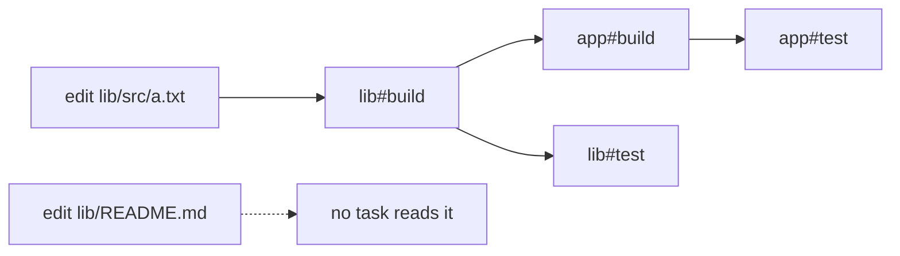

An affected run now picks the tasks a change reaches, and a run reads
only the locks. A README edit runs nothing, and a config edit waits for
`vx lock`.

This release has breaking changes: read
[Breaking changes](#breaking-changes) first.

**In this release**

- [Affected runs pick tasks, not projects](#affected-runs-pick-tasks-not-projects)
- [A run follows the lock](#a-run-follows-the-lock)
- [Failures print at the end](#failures-print-at-the-end)
- [Keyed variables reach the command](#keyed-variables-reach-the-command)
- [Fewer stale hits, and every stop says why](#fewer-stale-hits-and-every-stop-says-why)

## Affected runs pick tasks, not projects

`--affected` marked every task of a changed project. A README edit
reran the project's build and tests, and every dependant's.

Now a change marks a task only when it matches that task's inputs,
then the tasks that depend on it. Only the changed projects and their
dependants are looked at.



Here `lib` and `app` build and test `src/**`, and `app` depends on `lib`:

```sh frame="terminal"
$ vx run test --affected=HEAD~1     # only lib's README changed
Nothing affected: the change reaches no test task.
$ vx run test --affected=HEAD~1     # lib's src/a.txt changed
  Tasks     status  cache     ±usual    time   cpu    mem outputs  blocks worker         task
            success no-cache    +1ms    15ms   29%  1.8MB       —       3 local          packages/lib#build
            success no-cache    −2ms     4ms   67%  1.7MB       —       0 local          packages/lib#test
            success no-cache    +2ms     5ms   75%  1.8MB       —       1 local          packages/app#build
            success no-cache    +0ms     2ms  104%  1.7MB       —       0 local          packages/app#test
```

A task with `exec` and no `inputs` runs when its project, or one it
depends on, changed. A task has three kinds: with `exec` it runs; with
`inputs` and no `exec` it is a no-op task, a package whose sources are
its build; with neither it is a group. Editing a task's definition
makes it a new task, so it and its dependants miss and are affected.

See [Running tasks](../../docs/running-tasks/).

## A run follows the lock

A run read each config to check it against the lock, and refused one
edited since `vx lock`.

Now a run reads only `.vx/projects.lock` and `.vx/dependencies.lock`,
and runs `.vx/workspace.ts` as before. A config edit does nothing until
`vx lock`. `vx lock --check` shows what moved:

```sh frame="terminal"
$ vx lock --check
✗ vx lock --check  web/vx.config.mjs evaluates differently from the lock here — its config, a file it imports, or the environment it reads changed; run 'vx lock'

  tasks.build.exec.command: "mkdir -p dist && echo \"api: $VITE_API_URL\" | tee dist/en… → "mkdir -p dist && echo \"API: $VITE_API_URL\" | tee dist/en…
```

`turbo()` and `nx()` read no `turbo.json` or `nx.json` on a run either.
Their settings reach a run through the `.vx/workspace.ts` that
`bunx @vzn/vx-migrate` writes.

See [Lock](../../cli/lock/).

## Failures print at the end

vx held each task's output in memory, so a task that printed a flood
grew vx with it.

Now every task's output streams to its own file. One task streams to
the terminal from that file. A run of many tasks, here, on CI or on a
DTE worker, prints only the failed tasks' output, at the end:

```sh frame="terminal"
$ vx run test --all
  Tasks     status  cache     ±usual    time   cpu    mem outputs  blocks worker         task
            success no-cache    −3ms    12ms   38%  1.8MB       —       3 local          packages/lib#build
            success no-cache    +1ms    31ms   11%  1.8MB       —       1 local          packages/docs#build
            success no-cache       —     7ms   42%  1.7MB       —       0 local          packages/lib#test
            failed  no-cache       —     3ms   40%  1.7MB       —       0 local          packages/docs#test
            success no-cache    +2ms     7ms   56%  1.8MB       —       1 local          packages/app#build
            success no-cache       —     3ms   77%  1.7MB       —       0 local          packages/app#test

┌─ packages/docs#test > failed (exit 1)

packages/docs $ echo checking && echo "docs: broken link in README.md" >&2 && exit 1

├─ OUTPUT ────────────────────────────────────────────────────

checking
docs: broken link in README.md

└─ packages/docs#test ── (3ms) failed (exit 1)
```

See [Running tasks](../../docs/running-tasks/).

## Keyed variables reach the command

A variable in `inputs.env` went into the key but not to the command,
so a build keyed on `VITE_API_URL` never saw it.

Now `inputs.env` passes each variable it keys. It and
`exec.env.passThrough` take a name pattern, and the lock keeps the
pattern as written:

```ts title="web/vx.config.ts"
import { defineProject } from '@vzn/vx/config'

export default defineProject({
  tasks: {
    build: {
      exec: { command: 'vite build' },
      inputs: { files: ['src/**', 'index.html'], env: ['VITE_*'] },
      outputs: { files: ['dist/**'] },
      cache: true,
    },
  },
})
```

A new `VITE_API_URL` misses and builds; the same one replays.

See [Environment variables](../../docs/environment-variables/).

## Fewer stale hits, and every stop says why

A night of hardening closed paths that replayed a stale hit, hung, or
failed without a reason:

```sh frame="terminal"
$ vx run build
✗ vx run  @demo/web#build reads src/ui in inputs.files, a link into the project @demo/ui (packages/ui): a project's inputs never reach another project's files, so an edit there would replay a stale hit. Depend on a task of @demo/ui, or take the link back with "!src/ui" and name the files in inputs.workspaceFiles ("packages/ui").
```

- A remote cache download that stalls is asked again for up to 30 s, so a run whose tasks all passed no longer exits 1.
- `bun()` and `yarn()` refuse an install whose patched copies do not match the lockfile, naming `bun install --force`.
- A remote get that never answers is a miss, and a plugin call that never settles is named.
- A timeout names whose limit killed the task and how to raise it.
- `CI=no`, `off`, `false` or `0` is not CI, so a laptop never writes the remote by accident.

## Other noteworthy changes

- Branches that edit different projects merge their locks cleanly.
- A server's exit line comes after its last output, and a server vx stopped closes `stopped`.
- The footer, `vx last`, history and telemetry time a run from its wait for the run lock through its uploads.
- Refusals and hints name the right fix: a missing `;` shows the shell's error, and `vx run` with no task points at `bunx @vzn/vx-migrate`.
- `vx last`, help and refusals fit a narrow terminal, and a resize mid-run leaves no stale rows.
- With `@vzn/vx-dte`, a relay restart no longer uses up a machine's reconnect tries, and a server that died on a worker fails the tasks that need it.

## Breaking changes

- `.vx/projects.lock` is version 10 and `.vx/dependencies.lock` version 7: run `vx lock` once and commit both.
- A config edited or added since `vx lock` is no longer refused: the run uses the lock.
- `turbo()` and `nx()` read no `turbo.json` or `nx.json` on a run; Turbo `concurrency` and Nx `parallel` and `defaultBase` reach a run only through `.vx/workspace.ts`.
- `--affected` marks tasks by their inputs, not whole projects.
- A variable in `inputs.env` now reaches the command.
- A task with no `exec` and `inputs: { files: [] }` is refused.
- A run refuses an `inputs.files` link into another project that no `dependsOn` path reaches (`VX_E_NESTED_INPUT`).
- `vx lock` refuses a glob that reaches into a nested project, a project named with a leading `-`, a name listed twice in `inputs.env`, `exec.env.passThrough`, `exec.env.secret` or `tags`, a dependency rule with only `deny: []`, and `persistent.readyWhen: ''`.
- `--affected=` with no value is refused.
- A plugin's `setup` that returns a value fails; a `teardown` that returns one is warned.
- `PreparedRun.unlockedConfig` is removed, and `ui.Column`'s `align` is optional.

See [Upgrading](../../docs/upgrading/).

## How to update

```sh frame="terminal"
vx upgrade
```
